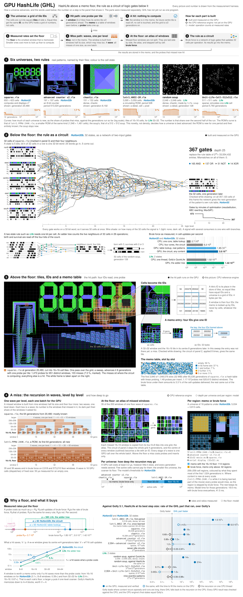
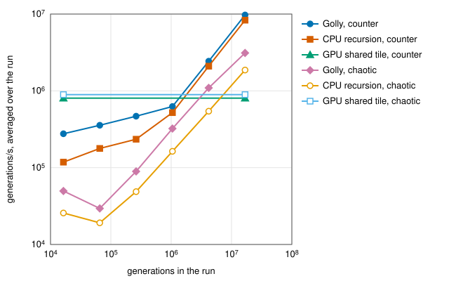
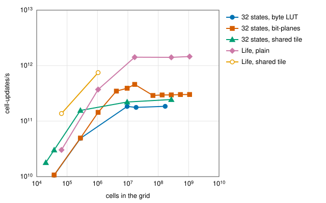
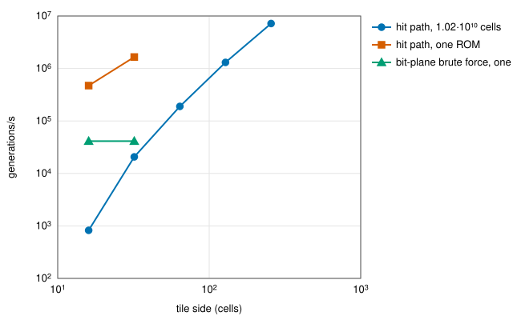

# HashLife on GPU

*[Author names, affiliations and contact details: to be supplied by the authors.]*



*GHL at a glance.* The strip on top is the algorithm: a universe held as a grid of tile IDs advances by one table probe per tile; a miss is resolved by the HashLife recursion, run in waves down to a memo floor; below the floor the rule is evaluated as a bit-sliced circuit. (1) Universes of the evaluation as cells, each with the share of its tile-steps that the memo does not hold yet, by generations run. (2) Below the floor: Hutton32b as its 367 gates, drawn from the netlist while it evaluates 32 cells of [`squares`], and the adder tree of the Life kernel (Section IV-C). (3) Above the floor: `squares` cut into 16×16 tiles, one sweep of the hit path with the results that its memo table lacked, one memo entry and the table itself (Sections IV-B and IV-D). (4) The miss path: the waves of one 64-generation step, the windows that a floor wave brute-forces, the depth per universe (the thresholds of Table XXVII) and the engine per region (Sections IV-E and IV-F). (5) The measured rates that set the floor (Section III) and the components' rates against Golly's (Table XI). Nothing in it is drawn by hand: `overview` runs the CPU reference engine on the patterns and [`ghl_diagram.py`] draws its output, the logged rates and the two gate networks, checking the circuit against the rule table on every cell of the frame it shows. GHL's components were measured separately (Table IX).

**Abstract**—HashLife, as implemented in Golly, is the state of the art for long runs of large cellular automata, but it memoizes down to blocks of a few cells, and on dense universes whose content does not repeat that costs more than it saves, by orders of magnitude. We present GPU HashLife (GHL), a HashLife for every rule of Golly's HashLife family (radius-1 neighbourhoods, up to 256 states) whose design follows from four rates measured on a GPU: brute-force evaluation, random table probes, concurrent inserts and dispatch latency. The cost of a probe in cell-updates of brute force sets a memo floor for each rule: windows below it are never memoized but evaluated by a bit-sliced network of the rule, at the same rate on any content. Above the floor GHL runs the HashLife recursion level-synchronously, one data-parallel wave per level, steps the top level as a positional sweep over tile IDs, and chooses its engine per region and per universe from novelty and active area. We evaluate its components on Conway's Life and on a 32-state rule. They beat Golly by one to four orders of magnitude on dense new content and, once their tables are learned, on dense content that recurs. On small universes run long enough to repeat, and on sparse recurring universes of the two-state rule, HashLife's doubling steps stay faster, and GHL falls back to the HashLife recursion. Final states match Golly's. GHL has not yet run as one program: the on-GPU miss path is specified and its primitives are measured, but it is not assembled.

**Index Terms**—Cellular automata, HashLife, memoization, hash consing, GPU computing, bit slicing, von Neumann neighbourhood.

---

## I. Introduction

HashLife [\[1\]] represents a universe as a hash-consed quadtree and memoizes the future of every node, so that regions which recur cost nothing to advance again. Golly [\[2\]] implements it for every rule of its family, from two-state Life-like rules to tables of 256 states, and for most engineered patterns it is the fastest simulator available: it advances idle circuits of up to millions of cells at up to $1.6 \cdot 10^{15}$ cell-updates/s ($2.7 \cdot 10^{9}$ generations/s), because every block in them has been seen before.

This paper develops a GPU HashLife for every rule of that family and evaluates it on rules at its two ends. Conway's Life has two states and the eight-cell Moore neighbourhood. Its engineered patterns are typically sparse and recurring, and HashLife is at home there, but even in Life dense chaotic content is HashLife's weak case: on a random soup of 2048 × 2048 cells Golly's HashLife takes 16× as long as its non-memoizing QuickLife for the first 4096 generations. Hutton32 [\[3\]], which Golly also implements natively [\[2\]], and Hutton32b [\[4\]], a variant with a 3×3 XNOR gate and two added rule sets in which the Hutton32-Computer project builds counters, ROMs, displays and a CPU, have 32 states and a five-cell von Neumann neighbourhood, so a rule table has $2^{25}$ entries. Their patterns are dense. A circulating ROM of 9.5 million cells has a period of 528 generations, and every 16×16 block of it differs from every other at every moment of the period. On it Golly reaches at best $2.7 \cdot 10^{7}$ cell-updates/s (2.9 generations/s) and runs out of its 8 GB just after one period, while one CPU core stepping cells through a lookup table does $3.4 \cdot 10^{8}$ cell-updates/s, 13× more. Brute-force stepping on a GPU reaches $1.74 \cdot 10^{11}$ cell-updates/s on real Hutton32 patterns with a lookup table (Section III-B), $3.0 \cdot 10^{11}$ on any content with the circuit of Section IV-C and $1.4 \cdot 10^{12}$ for Life, but cannot exploit recurrence at all.

We ask what HashLife should look like when its memo table lives in GPU memory, and answer with measurements. The contributions are:

1. A cost model of memoized stepping in four measured rates (Section III). Its central quantity, the exchange rate $\rho$ between a table probe and a brute-force cell-update, depends on the rule through its brute-force engine: about 47 for the 32-state rule and 380 for Life on the measured GPU. Together with the recursion's operation counts priced by the model, it places the memo floor at 16×16-cell windows for the 32-state rule and at 32×32 for Life (Sections III-C, IV-F and VI-G), rather than at HashLife's 2×2 leaves.
2. GPU HashLife (GHL), one algorithm for every rule of Golly's HashLife family and for dense, sparse, novel and recurring content (Section IV), whose parameters are set by measurements wherever they were varied (Table VIII). Its components were measured separately; GHL has not yet run as one program (Table IX).
3. Bit-sliced brute-force engines whose rate does not depend on content: a 367-gate circuit for Hutton32b, equal to the rule table on all $2^{25}$ neighbourhoods, at $3.0 \cdot 10^{11}$ cell-updates/s, and a 26-operation adder tree for Life-like rules at $1.4 \cdot 10^{12}$ (Section IV-C).
4. An evaluation on Life and on Hutton32 and Hutton32b against Golly 5.1 at its best step size, and against its QuickLife for Life and a four-core CPU brute-force loop for the 32-state rule, on 23 patterns and two sparse composite universes, that states the run length and the learning time with every ratio, compares final states with Golly's, and separates measured GPU components, a measured CPU implementation of the recursion and model projections (Sections V–VI).
5. A reproduction package in which every table is one command (Appendix A).

Section II reviews related work. Section III measures the costs and derives the model. Section IV presents GHL. Section V describes the evaluation, Section VI reports it, Section VII discusses projections and limitations, and Section VIII concludes.

## II. Related Work

### A. HashLife and Golly

Gosper's HashLife [\[1\]] memoizes, for each quadtree node of side $2s$, its centre $s/2$ generations later, and obtains a node's result from thirteen overlapping sub-results. Golly's generic implementation, [`ghashbase`] [\[2\]], uses 2×2 leaves, nodes of six pointers (48 B), scalar rule evaluation and a mark-and-sweep collector that runs when a memory limit is reached and keeps what is reachable from the current root. Its bottom memo entry, a 4×4 block advanced one generation, is worth four cell-updates. For two-state rules Golly has a separate HashLife, [`hlifealgo`] [\[2\]], whose leaves are 8×8 squares held as four 16-bit words; it steps 4×4 squares through a 65,536-entry table and memoizes a leaf's centre two generations ahead, worth 32 cell-updates. Golly also ships QuickLife, a conventional, non-hashing algorithm for Life-like rules [\[2\]]. lifelib [\[5\]] uses 16×16 bit-plane leaves and a bit-sliced SIMD leaf kernel on a single CPU thread; it is the closest relative of the memo floor proposed here.

### B. Parallel HashLife

Rokicki sketched a level-by-level ("lockstep") order of the recursion in pseudocode in 2014 [\[6\]]; no implementation was found. In 2018 he observed that "no parallel versions of hashlife have been seen that outperform a single-threaded version" [\[7\]]. LaForest [\[8\]] used a $2^{16}$-entry 4×4 → 2×2 lookup table on a GPU and reported 1.18× over plain Life; a static hash table with eviction was proposed and not built. gol_engines [\[9\]] is the only measured parallel HashLife found: CPU work stealing, Life only, between 31× and below 1× depending on the pattern.

### C. Brute-force stepping on GPUs

Bit-sliced Life kernels on GPUs reach $10^{12}\text{–}10^{13}$ cell-updates/s [\[10\]], [\[11\]]. Bit-plane and multi-state kernels in wgpu are described in [\[12\]], and von Neumann's 29-state automaton was simulated on a SIMD machine in [\[13\]]. No throughput figure for a von Neumann-family rule on a GPU was found.

### D. Hash tables on GPUs

GPU hash tables reach $2\text{–}4 \cdot 10^{9}$ lookups/s out of cache on large cards [\[14\]]–[\[17\]]. Address-translation effects on GPUs are characterised in [\[18\]], and dispatch overheads in WebGPU are measured in [\[19\]].

### E. Approaches not pursued

FFT convolution computes neighbour sums in *O*(*N* log *N*) time independent of radius and is used by SmoothLife and Lenia for radii of 10–30 [\[20\]], [\[21\]]. At radius 1 it loses: FFT Life is 3–8× slower than direct convolution in one benchmark [\[22\]], and Life written with PyTorch tensor operations is 121× slower than a bit-packed CUDA kernel in another [\[23\]]. For a non-totalistic 32-state rule the only linear statistic from which the next state follows is an injective code of the neighbourhood, which is the table index a direct kernel builds anyway. Generations can be skipped in closed form only for additive rules [\[24\]] and rules that decompose into linear ones [\[25\]]; predicting general automata is P-complete [\[26\]]. Coarse-graining [\[27\]] looks for automata on blocks of cells; the tile automaton of Section IV-D is an exact instance whose alphabet is discovered lazily.

Not found in the literature searched: a memo table of CA block transitions held in GPU memory; a bounded-depth HashLife that falls back to a brute-force kernel on a miss; a tile automaton swept positionally; a measured level-synchronous HashLife. The search could not reach forum threads behind logins.

## III. Measured Cost Model

### A. Platform

All figures were taken on an NVIDIA RTX 5060 Ti with 16 GB (driver 591.59, 448 GB/s, 32 MB L2), through wgpu 30 on Vulkan under Windows 11, with an Intel i5-6600K and 16 GB of RAM as host. Throughput is given throughout in cell-updates per second, cells × generations / s, where the cells are the pattern's bounding box. A universe composed of copies counts as one pattern and is measured as built at 16×16 tiles; tiled and random test grids count every cell. Padding that an engine adds (zero rings, tile alignment) is not counted, so two engines on the same workload are credited with the same cells and their rates compare directly. Where a pattern's speed is of interest, generations per second follow in parentheses. The replicator grows during a run; its rates are counted over its final bounding box and are therefore upper bounds. Empty cells inside the bounding box count too, so on sparse and idle universes, where memoization skips most of them, the rate is an effective one and can exceed the brute-force ceiling of $3.0 \cdot 10^{11}$; every such row states the cells it counts. Latency figures are given as time per generation.

### B. Four rates

Let a *tile* of level $L$ be a block of $s \times s$ cells, $s = 2^L$. A $2s \times 2s$ window determines its central tile $s/2$ generations later. Call that a *tile-step*; it is worth

$$V_L = s^2 \cdot \frac{s}{2} = 2^{3L-1} \text{ cell-updates} \qquad (1)$$

A tile-step can be obtained by brute force (cost $V_L / R_B$), by a memo hit (cost $1/R_P$), or by a miss (a probe plus the work to compute and store the result). Table I lists the four rates that price these options.

**TABLE I.** Cost constants measured on the RTX 5060 Ti

| Constant | Value | Measured with |
|---|---|---|
| $R_B$, brute-force evaluation, byte-LUT kernel | $1.74 \cdot 10^{11}$ cell-updates/s | `gpu-brute` |
| $R_B$, brute-force evaluation, bit-plane circuit | $3.0 \cdot 10^{11}$ cell-updates/s | `gpu-bitslice` |
| $R_B$, brute-force evaluation, Life (one bit per cell) | $1.41 \cdot 10^{12}$ cell-updates/s | `gpu-life` |
| $R_P$, random 32-byte fetch, table ≤ 16 MiB | $3.4\text{–}3.5 \cdot 10^{10}$/s | `gpu-probe` |
| $R_P$, table of 32 MiB | $1.3 \cdot 10^{10}$/s | `gpu-probe` |
| $R_P$, table of 128 MiB … 8 GiB | **$3.7\text{–}4.1 \cdot 10^{9}$/s, flat** (median $3.7 \cdot 10^{9}$) | `gpu-probe` |
| $R_I$, concurrent find-or-insert (32-bit CAS) | $1.0\text{–}1.3 \cdot 10^{9}$/s ($4.9 \cdot 10^{8}$/s for the first batch) | `gpu-insert` |
| Dispatch chained inside one compute pass | 3.2–4.2 µs (typically 3.4), of which 1.0 µs recording on the CPU | `gpu-latency` |
| New compute pass | 49–97 µs | `gpu-latency` |
| Separate `queue.submit` | 150–490 µs | `gpu-latency` |
| Dispatch and 16-byte read-back to the CPU | 0.1–2.4 ms | `gpu-latency` |
| Miss-path wave of 16 dispatches, indirect dispatch (three passes) | 230–490 µs | `gpu-latency` |
| The same with wgpu's indirect-call validation removed | 130–165 µs | `gpu-latency` |
| The same at fixed capacity with early exit (one pass) | **50–55 µs** | `gpu-latency` |

Ranges in the latency rows span separate runs on different days; the pass, submit and read-back costs varied most.

The byte-LUT kernel (`gpu-brute`) looks up each cell's next state in the $2^{25}$-byte rule table. It stores four cells per `u32`, runs 8×8 workgroups on ping-pong buffers with a zero ring, and advances all generations of a submit inside one compute pass. On a grid of $1.7 \cdot 10^{8}$ cells it reaches $1.74 \cdot 10^{11}$ (348 GB/s, 78 % of the bus's 448 GB/s); workgroup shape (8×8 to 64×4) changes this by less than 1 % and the DX12 backend by 4 %. The bit-plane kernel of Section IV-C reaches $3.0 \cdot 10^{11}$ at 1.25 bytes of traffic per cell-update instead of 2.

The probe rate is the same from 128 MiB to 8 GiB: there is no address-translation cliff, so VRAM converts directly into memo capacity. wgpu caps one binding below 2 GiB, so large tables are sharded across bindings; `gpu-probe` runs 8 × 1 GiB this way at full speed.

### C. The exchange rate

The ratio

$$\rho = \frac{R_B}{R_P} \qquad (2)$$

is the number of cell-updates that cost as much as one probe. The probe rate does not depend on the rule; the brute-force rate does, through the number of states and the kernel. With the median out-of-cache probe rate, $\rho$ is about 47 for the 32-state byte-LUT kernel, 80 for the 32-state bit-plane kernel and 380 for the bit-sliced Life kernel, which moves one bit per cell instead of five (Section IV-C); it is 5.0 for the byte-LUT kernel when the table fits L2. A memo level can pay only if $V_L > \rho$, and pays well only if $V_L \gg \rho$; Table II gives the best possible gain of a hit over brute force. For the 32-state rule the result of an 8×8 window is worth less than the probe that finds it and that of a 16×16 window three to five probes; for Life, whose $\rho$ is five to eight times larger, the same holds one level up, for windows of 16×16 and 32×32. The memo floor of a rule follows its $\rho$ (Section IV-F).

**TABLE II.** Value of a tile-step and best possible gain of a memo hit, $V_L / \rho$

| Tile | Window that yields it | Generations | $V_L$ | $V_L / \rho$, 32 states, byte LUT ($\rho = 47$) | $V_L / \rho$, 32 states, bit-planes ($\rho = 80$) | $V_L / \rho$, Life ($\rho = 380$) |
|---|---|---|---|---|---|---|
| 4×4 | 8×8 | 2 | 32 | 0.68× | 0.40× | 0.084× |
| 8×8 | 16×16 | 4 | 256 | **5.4×** | **3.2×** | 0.67× |
| 16×16 | 32×32 | 8 | 2,048 | 44× | 26× | **5.4×** |
| 32×32 | 64×64 | 16 | 16,384 | 350× | 205× | 43× |
| 64×64 | 128×128 | 32 | 131,072 | 2,800× | 1,640× | 345× |

Bold: the smallest window whose result is worth more than a probe, which is the rule's memo floor (Section IV-A).

On a CPU core the ratio comes out similar ($R_B \approx 3\text{–}4 \cdot 10^{8}$ with a table, $R_P \approx 10^{7}$ out of cache, assumed from a memory latency of about 100 ns rather than measured, $\rho \approx 30\text{–}60$) and rises to a few hundred with bit-sliced evaluation (Section VI-H). Golly's bottom memo entry is worth $V = 4$, an order of magnitude below $\rho$. That costs nothing while everything hits and a great deal when content is new.

### D. Memory per memoized cell-update

A Golly node is 48 B and covers four cell-updates at the bottom level; summed over levels, novel content costs about 13.7 B per cell-update. A tile-level memo entry is 32 B (four key IDs, a value, padding) and covers $V_L$ cell-updates; a new 16×16 tile adds 160 B of content at 5 bits per cell.

**TABLE III.** Memory per novel cell-update

| Scheme | Bytes per novel cell-update | One period of [`lotr1.ANSI-1M`] ($5 \cdot 10^{9}$ cell-updates) |
|---|---|---|
| Golly [`ghashbase`] | 13.7 | ≈ 70 GB |
| Memo at 16×16 tiles, entry only | 0.016 | 79 MB |
| Memo at 16×16 tiles, every result tile new | 0.094 | 473 MB |
| Memo at 32×32 tiles, entry only | 0.002 | 20 MB, over the two periods that 32×32 tiles take to learn |

By this model the ROM's period would need about 70 GB in Golly; measured, Golly fills 3.7 GiB within its first minute on the ROM and reaches its 8 GB limit just past the first period (Section VI-A). At a coarser grain the whole period fits a tenth of the GPU's memory. Tables are filled to at most 50 % (Table VI), so an entry occupies 64 B of VRAM. At 16×16 tiles a 16 GB card then holds about $2.5 \cdot 10^{8}$ entries ($5 \cdot 10^{11}$ cell-updates) when result tiles recur, or $7 \cdot 10^{7}$ ($1.5 \cdot 10^{11}$ cell-updates) when every result tile is new.

### E. The speedup law

With miss rate $\mu_L$ (fraction of tile-steps not found) and a miss costing $\kappa$ times the brute-force price of a tile-step, the speedup of memoized stepping over brute force is

$$S_L = \frac{1}{\rho / V_L + \kappa \mu_L} \qquad (3)$$

Memoization at level $L$ wins while $\mu_L < (1 - \rho/V_L)/\kappa$. For a miss that evaluates the whole $2s \times 2s$ window plus two inserts, $\kappa \approx 4.5$ at $L = 4$ and the break-even miss rate is about 22 %; evaluating contiguous misses as one region with a halo approaches $\kappa \approx 1.1$ and break-even near 89 %.

Table IV gives $\mu_L$ for the flat tile automaton of Section IV-D on the 32-state patterns, measured over the second half of each run so that start-up transients are excluded.

**TABLE IV.** Miss rate $\mu_L$ of the flat tile automaton by tile size

| Pattern | 8×8 | 16×16 | 32×32 | 64×64 | 128×128 |
|---|---|---|---|---|---|
| [`advanced counter v2`] (262 k gens; period 513,024) | 0.41 % | 1.70 % | 5.4 % | 9.4 % | 12.2 % |
| [`32x32 movie`], playing | | 0.16 % | | | |
| [`16x16 movie`] | | 0.12 % | 0.56 % | | |
| [`Segmented ROM (256k)`] | | 0.07 % | 0.59 % | | |
| [`component-basis`] | | 0.09 % | 0.64 % | | |
| [`squares`] | | 3.5 % | 7.0 % | | |
| [`chaotic`] | 10.5 % | 25.5 % | 34.9 % | | |
| [`lotr1.*`] ROMs | | 96 % for 528 gens, then 0 | 0 after 1,056 gens | | |
| [serial] and [parallel] displays, [demultiplexer], [`cpu`], [`BIN2BCD`] (idle) | | 0 | 0 | | |

The counter never repeats a global state within the run, yet 98.3 % of its 16×16 tile-steps are repeats. Inside the recursion a window is requested only when its parent missed. Table V gives the conditional miss rate per window size: of the windows requested because their parent missed, the fraction that missed too.

**TABLE V.** Conditional miss rate per window size (32-state patterns, 8×8 base tiles)

| Window | [ROM][lotr1.PPMd-244K.rle], first 512 gens | [counter] | [`chaotic`] | [`32x32 movie`] | [`squares`] |
|---|---|---|---|---|---|
| 16×16 | 51 % | 21 % | 31 % | 33 % | 29 % |
| 32×32 | 99.7 % | 29 % | 57 % | 38 % | 35 % |
| 64×64 | 99.8 % | 36 % | 90 % | 45 % | 36 % |
| 128×128 | 99.9 % | 39 % | 93 % | 65 % | 51 % |
| 256×256 | 99.5 % | 45 % | 89 % | 74 % | 55 % |
| Live cells in bounding box | 86 % | 64 % | 80 % | 77 % | 35 % |

Four of the five patterns are equally dense and want opposite treatment. The counter and `squares` miss 21–55 % at every scale, so every level earns its keep; `chaotic` and the movie climb to 57–93 % and 65–74 % at the largest windows. The ROM, while it is new, misses everything above 16×16: no tile size helps until the whole period has been seen, after which the largest tiles hit too. **The signal that selects an engine is novelty, not density.**

## IV. The GHL Algorithm

### A. Overview

GHL applies to every rule that Golly's HashLife family runs [\[2\]]: a deterministic transition function of a radius-1 neighbourhood (Moore, von Neumann, hexagonal or one-dimensional) over at most 256 states, given in B/S notation, as a rule table or as a rule tree. Two properties make HashLife's recursion independent of the rule, and GHL keeps both: for every radius-1 neighbourhood a $2s \times 2s$ window determines its central $s \times s$ tile $s/2$ generations later, and above the base tiles every memo key is a tuple of tile IDs. What depends on the rule is the brute-force engine below the floor and, through its rate, the floor itself. A cell occupies as many bit-planes as its states need bits: one for Life, five for Hutton32b. As in Golly's HashLife, a block of state 0 must stay state 0; Golly runs a rule in which an empty neighbourhood gives birth (B0) as one or two rules without B0, alternated between even and odd generations [\[2\]], and GHL inherits that conversion.

GHL is HashLife with five changes, each forced by a measurement of Section III:

1. **A memo floor set by the rule.** Windows below the floor are never memoized; a missed floor window is brute-forced. The floor is the smallest window whose result is worth more than the probe that finds it (Table II): the 16×16 window for Hutton32b, worth 3.2 probes at the bit-plane rate where the 8×8 window is worth 0.40, and the 32×32 window for Life, worth 5.4 where the 16×16 window is worth 0.67. The sweep on top starts at tiles of the floor's side, where a hit is worth 26 and 43 probes. The operation-count model confirms both floors (Section VI-G).
2. **A bit-sliced brute-force engine.** Below the floor, cells are stepped as bit-planes by a network of the rule's logic, at the same rate on any content (Section IV-C).
3. **A level-synchronous schedule.** The recursion runs level by level, one data-parallel wave per level, so that every stage is a GPU dispatch over a batch (Section IV-E).
4. **A positional sweep on top.** The top level is a flat array of tile IDs stepped as a tile automaton: one gather and one probe per tile (Section IV-D).
5. **Choice by novelty and active area.** Per region, the engine follows novelty (Table V); per universe, the depth follows the active area, because dispatch latency is paid once per generation by the whole universe (Section IV-F).

Algorithm 1 is the whole method; Algorithms 2 and 3 are its two non-trivial steps.

```
Algorithm 1  GHL: advance a universe          [B] built and measured on the GPU  [C] on the CPU only
                                              [M] model only  [-] specified, not built
Input: a rule R; the universe as hash-consed base tiles (8x8 cells for Hutton32b, 16x16 for Life); tables in VRAM
 0  K <- the bit-sliced engine of R [B]; f_R <- the floor that rho of K sets (Table II) [M]
 1  for each epoch (a fixed number of waves, all inside one compute pass per frame):
 2      A <- live cells in active blocks
 3      if A < A1:                                    # dispatch latency dominates
 4          run the fastest of {host HashLife recursion [C], shared-tile kernel (k = 16) [B],
            plain bit-plane kernel [B]}; time the others again with exponential back-off [-]
 5      else:                                         # throughput dominates
 6          f <- f_R one level coarser if A < A2, else f_R        # universe-wide floor [M]
 7          for each wave of the epoch:
 8              HitSweep(top level s, active blocks)  # one gather + one probe per tile [B]
 9              Solve(misses of the sweep, floor f)   # Algorithm 2 [C]
10              step regions in plain-cells mode as cells under a region-level memo [M]
11          Controller(regions)                       # Algorithm 3 [M]
12          raise s while its hit rate stays above 40 %; lower it when it stops paying [M]
13      hash the ID grid (global cycles); rebuild tables past their load limit [-]
```

```
Algorithm 2  Solve(l, Q): level-synchronous HashLife with a memo floor
Input: level l, batch Q of distinct windows; every step is one dispatch at fixed capacity
 1  M <- windows of Q whose probe misses
 2  if l is the floor f:
 3      expand M into an atlas; step it by brute force on bit-planes; intern the centres
 4  else:
 5      S1 <- distinct nine overlapping sub-windows of each m in M;      Solve(l-1, S1)
 6      S2 <- distinct four windows built from those nine results;       Solve(l-1, S2)
 7      result(m) <- the node of the four results
 8  insert (M, results) with the claim protocol; commit; re-probe the missed positions
    on overflow of a fixed capacity: leave a sentinel, replay the wave with a larger one
```

```
Algorithm 3  Controller: engine per 256x256 region, 16-generation steps
 1  start every region at the floor f
 2  coarser alternatives: price them from the region's own statistics (requests and misses
    above a level do not depend on what happens below it); switch when 15 % cheaper
 3  finer alternatives: subdivide one floor miss in sixteen and price the result
 4  from plain cells: a two-step trial of f at most every 16 steps, the interval doubling
    up to 256 steps while trials fail
```

Fig. 1 shows the tile automaton that the sweep steps; Table VI the data it keeps on the GPU; Table VIII every parameter and the measurement that sets it.

```
phase A (tiles at k*s)          phase B (tiles at k*s + s/2)        phase A
+----+----+----+                    +----+----+                 +----+----+----+
| a  | b  | c  |   R(a,b,d,e) ->    | p  | q  |                 |    |    |    |
+----+----+----+   R(b,c,e,f) ->    +----+----+  R(p,q,r,t) ->  |    | e' |    |   e' = e after s generations
| d  | e  | f  |   ...              | r  | t  |                 |    |    |    |
+----+----+----+                    +----+----+                 +----+----+----+
| g  | h  | i  |
+----+----+----+
```

**Fig. 1.** The positional sweep. Each tile-step maps four tile IDs to the ID of the centred tile $s/2$ generations later; two alternating phases bring the lattice back.

### B. Data in VRAM

**TABLE VI.** Data structures in VRAM

| Structure | Layout | Size |
|---|---|---|
| ID grids A, B | one `u32` per tile of the sweep level, two phases | 4 B per 256 cells at 16×16 tiles |
| Memo table per level | open addressing, linear probing; 32 B entries: four key IDs, value, spare | $2 \cdot 10^{8}$ slots in 6.4 GB, filled to at most 50 % |
| Claim words | one `atomic<u32>` per slot | 4 B per slot |
| Tile store | base tiles as bit-planes, indexed by tile ID | 40 B per distinct 8×8 Hutton32b tile, 32 B per 16×16 Life tile |
| Active-block list | origins of blocks that are not known to be empty | a few words per block |
| Atlas | scratch bit-plane grid for windows being brute-forced | sized to the miss batch |

A node's ID is its slot index, so there is no separate allocator and the children of an ID are a direct read. Entries never move; reclaiming space is a rebuild. A 100k × 100k universe is 151 MiB per ID buffer at 16×16 tiles, where a byte per cell would need 10 GB.

### C. Brute-force engine: the rule as a bit-sliced network

The engine is the fastest of three forms, each equal to the rule on every neighbourhood. *Outer-totalistic two-state rules* (Life-like, in B/S notation) depend only on the centre and the number of live neighbours: a carry-save adder tree of 26 two-input operations adds the eight neighbour bits of 32 cells into a four-bit count, and the B and S sets are decoded from it. *A rule given as a table* can be synthesised into a bit-sliced circuit; for Hutton32b it has 367 gates. *Where no circuit is available*, a kernel looks the table up directly when its entries fit in memory ($2^{25}$ bytes for 32 states on the von Neumann neighbourhood), or walks Golly's rule tree with one dependent load per neighbour; the byte-LUT kernel of Section III-B is this form for the Hutton32 rules, and a tree kernel was not built.

For Life the network needs one plane. An invocation loads the word of 32 cells and the eight words around it, forms the eight neighbour words with shifts, and evaluates the adder tree and the decode, about 60 operations for 32 cells. It moves 2 bits per cell-update instead of 10 and reaches $1.41 \cdot 10^{12}$ cell-updates/s on large grids (Section VI-C).

For Hutton32b the rule tells apart 15 classes of states per neighbour and 29 for the centre. Starting from a network written by hand from the rule's structure (473 gates), global resubstitution with observability don't-cares, ABC rewriting scripts run through Yosys, and an inverter placement solved as MaxSAT reduce canonical Hutton32b to **367 gates** (165 AND, 137 OR and 14 XOR gates with two inputs, and 51 NOT; depth 25), reached after 24 minutes of a 25-minute optimisation budget. Every intermediate network was kept only if it agreed with the table on all $2^{25}$ entries; the final netlist, its WGSL emission and its Rust emission were each checked exhaustively, after a deliberately corrupted gate was confirmed to be caught. The network is not proven minimal.

Applied to bit-planes, the gates update 32 cells per operation. A cell is five bits in five `u32` words, one per bit; an invocation loads its group and the groups above and below, forms the east and west neighbours of each plane with two shifts and an OR, evaluates the network and stores five words. Table VII compares this form with the alternatives.

**TABLE VII.** Three ways to evaluate the rule without the $2^{25}$-byte table

| Form | What it is | Cost per cell-update | Measured |
|---|---|---|---|
| A. Scalar | the 25-bit neighbourhood in one register; a straight-line program yields the 5 output bits | 364 32-bit operations | CPU: $1.5\text{–}2.5 \cdot 10^{7}$/s; the table lookup does $3.3\text{–}6.0 \cdot 10^{8}$ on a real pattern |
| B. Bit-sliced | the same network; every operand holds one bit of 32, 64 or 256 cells | 12.4 operations per cell at 32 bits | GPU: $3.0 \cdot 10^{11}$/s; CPU: $0.9\text{–}4.5 \cdot 10^{9}$/s |
| C. Small tables | the table factored through class codes, `T5[Tn[c,n] + Te[c,e] + Ts[c,s] + Tw[c,w]]` | 5 loads from 14,971 B | CPU: $2.6\text{–}4.5 \cdot 10^{8}$/s |

Form A loses to the table by 2.5–34×; it pays only when the other bits of every register carry other cells, which is form B. Form C fits an L1 cache but is still 3–10× slower than bit-planes on the CPU. A one-table variant with a 21-bit class index (2 MiB) was measured on the GPU at $4.2 \cdot 10^{10}\text{–}1.3 \cdot 10^{11}$/s, and a four-load chain of 10,592 B was sized but not built.

GHL uses the network of either rule in two kernels. The **plain kernel** steps the grid once per dispatch with 8×8 workgroups. The **shared-tile kernel** gives a workgroup a tile of bit-plane words plus a halo of $k$ rows, loads it into workgroup-shared memory and steps it $k$ generations with one evaluation per thread per generation and a barrier between generations; $k$ is limited to 32 by the one-word halo.

### D. Hit path: the positional sweep

Hash-consing gives every distinct tile a small integer ID. The memoized map

$$R_L : (\mathrm{ID}_{nw}, \mathrm{ID}_{ne}, \mathrm{ID}_{sw}, \mathrm{ID}_{se}) \mapsto \mathrm{ID}_{c} \qquad (4)$$

where $\mathrm{ID}_{c}$ is the centred tile $s/2$ generations later, is itself a cellular automaton over tile IDs with a 2×2 neighbourhood on a lattice that shifts by half a tile each step (Fig. 1). Simulating the original automaton for $s/2$ generations is one gather of four IDs and one probe per tile, independent of $L$. Every window is evaluated once per sweep, so the overlap that costs HashLife thirteen sub-calls for eight results' worth of work is shared for free, and nothing above the sweep level is hashed.

The hit path is one dispatch per sweep with no atomics, because inserts happen in separate dispatches. A sweep of $n_d$ chained dispatches advancing $2^{L-1}$ generations costs at least $n_d \cdot 3.4\ \mu\text{s} / 2^{L-1}$ per generation, however small the universe: 0.42 µs for a hit-only sweep at 16×16 tiles.

For sparse universes the sweep runs over a list of active blocks. The key of four empty tiles maps to the empty tile, so a block that is empty with an empty one-block border stays empty and is skipped exactly; a block joins the list when a border tile of a neighbour becomes non-empty.

### E. Miss path: level-synchronous recursion

Algorithm 2 is HashLife's recursion in breadth-first order: instead of descending depth-first, each level processes one batch of distinct nodes per wave. With floor $a$ the bottom result advances $2^{a-1}$ generations, so $T$ generations need $T / 2^{a-1}$ dependent waves unless a higher level hits; batches inside a wave are parallel and waves are not. Fixed cost per wave therefore bounds every pattern whose misses are few but constant, and a handful of nodes per wave is cheaper on the host CPU, where a wave costs microseconds and no dispatch. Algorithm 1 accounts for both: it runs the recursion on the host when that is faster (line 4).

A missed window is resolved entirely on the GPU:

* **Deduplicate and claim.** WGSL has only 32-bit compare-exchange, so a 128-bit key cannot be installed atomically. Each slot has a claim word that is 0 (empty), $j+1$ (claimed in this batch by element $j$) or has bit 31 set (committed earlier). A thread that finds a slot claimed by element $t$ compares against element $t$'s key read from the immutable batch input, never from the table; committed slots are immutable and compared in place; a second dispatch marks the batch's claims committed. One dispatch resolves a whole batch without locks.
* **Expand, evaluate, intern.** Each distinct missing key copies its four tiles into a $2s \times 2s$ window of the atlas, the brute-force engine advances the atlas $s/2$ generations (garbage from a neighbouring window travels one cell per generation and cannot reach the central tile), and the central tile is hash-consed by content with the same claim protocol.
* **Publish.** The result ID is written into the memo entry and the missed positions are re-probed.

The number of misses, and then of distinct misses, is known only on the GPU. GHL does not size dispatches indirectly, which costs 260–490 µs per wave in wgpu (Table I). Every stage is dispatched for a fixed capacity taken from stale, asynchronously read miss counters, and invocations beyond the live count return at once: a wave of 16 dispatches then costs 51–55 µs, and an idle 64-thread workgroup costs about 1 ns once the 3.2 µs fixed cost of a dispatch is paid. A wave that overflows its capacity leaves a sentinel in the affected tiles and is replayed from the last snapshot with a larger capacity. The CPU never sits in the per-wave path.

### F. Choosing tile size, floor and engine

*Sweep tile.* A level that never hits adds one failed probe and one insert per eight tile-steps below it, at most $1/7$ over all higher levels together. With $p$ and $\iota$ the prices of a probe and an insert, a level pays for itself once its hit rate exceeds

$$h^{*} = \frac{p + \iota}{8p + \iota} \qquad (5)$$

about 40 %. GHL raises the sweep tile while its hit rate stays above that. Each level takes twice as long to learn as the one below: a tile of side $2^L$ sees the same content again only after $\mathrm{lcm}(528, 2^L)$ generations on the ROM.

*Floor.* Brute-forcing large isolated windows is the worst choice everywhere: each carries its own halo and the recursion asks for thirteen of them where eight would tile the result. Below 16×16 windows hashing costs more than the cells: an 8×8 window is 0.7 ns of brute force and 3.5 ns of bookkeeping. For Hutton32b GHL therefore stores 8×8 base tiles and brute-forces missed 16×16 windows (F16); Table XXIII gives the measurements. The floor of a rule follows its $\rho$. For Life, with $\rho$ about 380, GHL stores 16×16 base tiles and brute-forces missed 32×32 windows (F32): priced at the Life kernel's rate, a Life soup runs fastest at F64 and the recurring Unit Life Cell at F16, and F32 is within 15 % of the best on both (Table XXIV).

*Engine per region.* The recursion is already a per-window switch between memo and brute force: a window that hits costs a probe, one that misses at the floor is brute-forced. A second engine pays only where content is new at every scale below the region: plain cells stepped per 256×256 region, with memo only above the region. Algorithm 3 enters it on sustained novelty at 32×32 windows and above and leaves it lazily. Two simpler controllers failed and shaped this one (Section VI-G): experiments must jump to a depth where being wrong is cheap, and the evidence for finer depths must be sampled, not obtained by whole-step trials. While anything is being learned, steps stay at 16 generations, because a step that does not divide a period multiplies the learning time.

*Depth per universe.* A missed floor window needs about seven dispatches plus one per brute-forced generation, and the levels above add about five per floor wave. Latency is global: one region at a shallow floor makes the whole universe pay that floor's dispatches. GHL therefore chooses the universe-wide floor $f$ that minimises

$$C(f) = L(f) + \sum_{r} w_r(f) \qquad (6)$$

with $L(f)$ the dispatch latency per generation at floor $f$ and $w_r(f)$ the work of region $r$; regions may only go coarser than $f$. With the counter's measured work per region this gives the thresholds $A_1$ and $A_2$ of Algorithm 1 (Table XXVII).

**TABLE VIII.** Parameters of GHL and the measurements that set them

| Parameter | Value | Set by |
|---|---|---|
| Base tile | half the floor: 8×8 cells in five bit-planes (Hutton32b), 16×16 cells in one (Life) | floors (Tables XXIII, XXIV) |
| Memo floor | Hutton32b: 16×16 windows (F16), 32×32 (F32) for mid-sized active areas; Life: F32 | $V_L / \rho$ (Table II), floors (Table XXIII), depth (Table XXVII) |
| Brute-force engine | Hutton32b: 367-gate circuit on five bit-planes; Life: adder tree on one plane | Tables XIII, XIV, XVI |
| Generations per dispatch on small grids | $k = 16$ in a shared tile | Tables XIII, XVI |
| Sweep tile | start at 16×16; raise while the hit rate exceeds 40 % | (5), Tables XVII, XIX |
| Step while learning | 16 generations | Table XXV |
| Engine region | 256×256 cells; plain cells on sustained novelty at ≥ 32×32 windows | Tables V, XXV, XXVI |
| $A_1$: below it, no memo | Hutton32b: $\approx 1.0 \cdot 10^{6}$ active cells | Table XXVII |
| $A_2$: F32 between $A_1$ and $A_2$, F16 above | Hutton32b: $\approx 1.3 \cdot 10^{7}$ active cells; for another rule both follow from (6) and its work per region | Table XXVII |
| Miss-path dispatch | fixed capacity with early exit, one pass, ≈ 54 µs per 16-dispatch wave | Table I |
| Memo entries | 32 B, open addressing; tables sharded across bindings below 2 GiB | Table I |

### G. Exactness

Keys are compared in full and tiles by content. There is no probabilistic hashing anywhere, and the result of every engine is bit-identical to per-cell stepping. IDs are canonical, so two ID grids are equal exactly when the universes are; a hash of the grid taken every epoch detects a globally periodic universe. The memo is a cache: dropping it, for instance when a table is rebuilt from the entries reachable from the current grids, costs a relearning transient and never correctness.

## V. Evaluation Methodology

### A. Baseline

The state-of-the-art baseline is Golly 5.1's command-line `bgolly` without rendering, with an 8 GB memory limit (`-M 8000`) on a 16 GB host. Each pattern is run at one to seven step sizes, and the step size with the best median rate is reported; every ratio uses that figure. Golly 5.1 is the official 64-bit Windows release of November 2026, built from branch `master` of Golly's repository [\[2\]]. The release is not tagged and its build commit is not recorded, but Golly's source is the same in every commit from 9a7079a8 ("updated version to 5.1", 2026-11-06) to 53bdb74e (2026-11-15), the head of `master`; the commits in between change only patterns and the change log. All references to Golly's source are to commit 53bdb74e. Life patterns run under Golly's two-state HashLife (`-a HashLife`) and, as a non-memoizing baseline, its QuickLife. Hutton32b patterns run under RuleLoader with the published [`Hutton32b.rule`][Hutton32b.rule] [\[4\]] and Hutton32 patterns under Golly's native JvN algorithm, which is equal to [`Hutton32.table`] [\[3\]] on all $2^{25}$ neighbourhoods (Appendix B). The published Hutton32b rule is an `@TABLE`; Section VI-A also reports Golly with the same rule as an `@TREE`. Load time is subtracted. The brute-force baselines are, for the 32-state rule, the byte-LUT GPU kernel of Section III-B and the bit-sliced circuit on all four cores of the host CPU (Section VI-H), and for Life Golly's QuickLife.

### B. Patterns

*Life.* Ten patterns from Golly's pattern collection and random soups. The [Unit Life Cell] (511 × 511, period 5760) is a metacell that simulates one Life cell; it plays the part of the ROM as a large periodic pattern that is mostly empty space and signal paths. The [metapixel galaxy] is an array of OTCA metapixels, and [`ruler`], [`wedge-grow`], [`gotts-dots`], [`metacatacryst`], [`catacryst`], [`mosquito5`], [`jagged`] and [`totalperiodic`] are the growing, eventful patterns of Golly's HashLife folder. A soup is a square in which every cell is alive with probability ½, drawn from a fixed hash (`life-soup`); it is the dense chaotic case. All are listed in [`README.md`].

*Hutton32 and Hutton32b.* Fifteen patterns of the Hutton32-Computer collection and two further 8-bit counters, a [Hutton32b counter] of the same size as `advanced counter v2` (191×197) and a [Hutton32 counter] (633×449) that is tiled into the large brute-force grids, all listed with their rules and bounding boxes in [`README.md`]: an 8-bit counter ([`advanced counter v2`], 191×197, period 513,024), an active display ([`squares`], 650×423), a chaotic circuit ([`chaotic`], 151×132), two circulating ROMs ([`lotr1.ANSI-1M`], 3095×3059, and [`lotr1.PPMd-244K`], 1548×1461, period 528), circuits that are idle most of the time ([serial] and [parallel] displays, a [segmented ROM], a [demultiplexer], two movies, [16×16] and [32×32], a [CPU], a [BCD converter], a [component sheet]) and Tim Hutton's [replicator], which grows to 6813×6691. Large universes are built from phase-shifted copies, so that no two large blocks are equal at the same moment. Copies are placed at whole-tile offsets, so one learned period of a pattern covers every copy; Section VI-D measures copies at arbitrary cell offsets. The sparse universe's list of active blocks is fixed when the universe is built, so the activation of new blocks described in Section IV-D is not exercised.

### C. Verification

Every GPU throughput figure was followed by a read-back and a cell-exact or tile-exact comparison with the CPU. The CPU reference engine agrees with per-cell stepping in 22 configurations and with Golly (same population, bounding box and content hash) on 12 Hutton32 and Hutton32b patterns and 10 Life patterns after 16,384 to $2^{24}$ generations, and on two sparse universes after 16,384 generations. The Life kernel on the GPU ends a 2048 × 2048 soup in Golly's state after 4096 generations. The harness's CPU rule implementation and the circuit equal the canonical rule tables on all $2^{25}$ neighbourhoods (Appendix B).

### D. Repetitions and timing

Every GPU rate in Section VI is the median of five timed runs that follow one untimed warm-up run in the same process, with the five runs' range given where it matters; each run restarts from the same initial state, and the verification checks the last one. Golly rates are medians of three runs per step size, with Golly's load time subtracted, and its peak working set is recorded. In the head-to-head of Section VI-F both programs are run, without writing output, until the runs add up to at least a second (at most five runs), and the median is reported; the final states come from a separate untimed run. All runs were made one at a time on an otherwise idle machine. The timed region of a GPU run covers recording, submission and execution of its commands; for a chained dispatch, recording takes 1.0 µs of the 3.2 µs it costs. Golly's runs on the ROM are bounded at 60 s per step size and report the generations reached; a longer run is reported separately. Raw logs of every run are in [`logs/`].

### E. Implementation status and evidence classes

GHL is not yet one program. Table IX lists where each component runs in this evaluation. Results are labelled accordingly: **GPU** (measured on the GPU and verified), **CPU** (the same algorithm measured on the CPU reference engine) and **model** (operation counts of the reference engine priced with the constants of Table I).

**TABLE IX.** Implementation status of GHL's components

| Component | Status | Evidence |
|---|---|---|
| Plain and shared-tile bit-sliced kernels, Hutton32b and Life | built, GPU | GPU |
| Positional hit-path sweep (dense) and active-block sweep (sparse) | built, GPU; table learned on the CPU; active-block list fixed, block activation not built | GPU |
| Claim protocol for find-or-insert | built, GPU benchmark | GPU |
| Fixed-capacity 16-dispatch wave | built as a benchmark of empty waves | GPU |
| Level-synchronous recursion with memo floor | built, CPU reference engine ([`hl.rs`]) | CPU |
| Per-region floors, plain-cells mode, controller, depth choice | operation counts on the CPU, priced with measured constants (`adapt`) | model |
| GPU miss path (expand, evaluate on atlas, intern) as one pipeline | specified, not built | model |
| Racing of executors, table rebuild, cycle detection | specified, not built | none |

## VI. Results

### A. The baseline

**TABLE X.** Golly 5.1 on the evaluated patterns at the best step size (HashLife; for Life also QuickLife); medians of three runs

| Pattern | Size | Generations | Best step | Golly, cell-updates/s (gens/s) | Other step sizes, gens/s | Peak working set |
|---|---|---|---|---|---|---|
| [`advanced counter v2`] | 191 × 197 | $2^{20}$ | 262,144 | $2.3 \cdot 10^{10}$ (609,604) | 49,477 at 1; 333,849 at 8; 553,050–604,630 at 64 to 32,768 | 119 MiB; 1.8 GiB at step 1 |
| [`squares`] | 650 × 423 | 65,536 | 1024 | $8.2 \cdot 10^{9}$ (29,761) | 24,310 at 8; 29,241 at 64; 29,443 at 16,384 | 235 MiB |
| [`chaotic`], active phase | 151 × 132 | 16,384 | 1024 | $9.4 \cdot 10^{8}$ (47,158) | 31,995 at 8; 43,773 at 64 | 36 MiB; 22 collections |
| [`lotr1.ANSI-1M`], first minute | 3095 × 3059 | 128–168 | 8 | **$2.7 \cdot 10^{7}$** (2.9) | 1.4 at 1; 2.7 at 16; 2.2 at 64 | 3.7 GiB after a minute; 8 GB, its limit, at generation 538 |
| [`32x32 movie`], playing | 928 × 1513 | 65,536 | 1024ᵃ | $1.4 \cdot 10^{10}$ (9,832) | | |
| [Hutton replicator] | grows to 4564 × 3187 | 65,536 | 4096ᵃ | at most $3.5 \cdot 10^{11}$ (24,186) | | |
| Seven idle circuits ([serial] and [parallel] displays, [segmented ROM], [demultiplexer], [`16x16 movie`], [`cpu`], [`BIN2BCD`]) | $1.2 \cdot 10^{5}\text{–}5.7 \cdot 10^{6}$ cells | $2^{24}$ | 1024ᵃ | $5.0 \cdot 10^{12}\text{–}1.6 \cdot 10^{15}$ ($4.9 \cdot 10^{6}\text{–}2.7 \cdot 10^{9}$) | | fully memoized; the rate grows with the run |
| *Life:* a random soup (`life-soup`), dense and chaotic | 2048 × 2048 | 4096 | 64 | HashLife $9.1 \cdot 10^{8}$ (218); QuickLife **$1.45 \cdot 10^{10}$** (3,464) | HashLife 201 at 1024; QuickLife 3,359 at 1 | HashLife 1.8 GiB; QuickLife 5 MiB |
| [Unit Life Cell] | 511 × 511 | $2^{20}$ | 65,536 | HashLife $5.5 \cdot 10^{12}$ ($2.1 \cdot 10^{7}$); QuickLife $1.32 \cdot 10^{10}$ (50,434) over 23,040 gens | HashLife $1.5 \cdot 10^{7}$ at 1024, $1.7 \cdot 10^{7}$ at $2^{20}$ | 11–13 MiB; QuickLife 4 MiB |
| [Metapixel galaxy] and eight eventful patterns of Golly's HashLife folder | 56 × 60 to 59,739 × 14,663 | $2^{20}$ or $2^{24}$ | 1024ᵃ | $4.5 \cdot 10^{5}\text{–}2.1 \cdot 10^{7}$ gens/s | | |

ᵃ One step size, from the head-to-head runs of Section VI-F. The ROM's runs stop after 60 s; its rate is the generations reached over that time.

On the ROM Golly is bounded by memory, not by its step size. Every step size fills 3.7 GiB within a minute, and a run at step 1 with a ten-minute limit reached Golly's 8 GB limit at generation 538, just past the first period, and stopped with an error after 431 s (1.25 gens/s). With Hutton32b converted to an `@TREE` rule (6,582 nodes, written by the harness's `ruletree`), Golly is 5–12 % faster than with the published `@TABLE`: 655,566 against 609,604 gens/s on the counter, 53,018 against 47,158 on `chaotic` and 3.0 against 2.9 gens/s on the ROM. The ratios below use the `@TABLE` rule; with `@TREE` they shrink by at most 12 %. On the ROM one CPU core stepping cells through the byte table does $3.4 \cdot 10^{8}$ cell-updates/s (36 gens/s), 13× Golly; four cores running the bit-sliced circuit do $6.5 \cdot 10^{9}$ (Section VI-H), and the byte-LUT GPU kernel does $1.84 \cdot 10^{11}$ (19,403 gens/s).

On Life, Golly's two algorithms divide the work between them. On a random soup its HashLife holds 1.8 GiB and runs at 218 generations/s, 16× slower than its non-memoizing QuickLife, which needs 5 MiB. On the Unit Life Cell, which repeats every 5760 generations, HashLife is 420× faster than QuickLife (21.1 M against 50,434 generations/s) once its step has grown to 65,536 generations.

### B. Overall comparison

Table XI places GHL's components against Golly and the brute-force baselines on every workload class. GHL has not run as one program (Table IX), so each row names the component that ran; where Algorithm 1 would race candidates, the component was chosen by hand. Ratios are against Golly's fastest measured run at the run length given.

**TABLE XI.** GHL's components against Golly 5.1 HashLife and the brute-force baselines, in cell-updates/s (generations/s)

| Workload | Generations | Golly 5.1, fastest run | CPU brute force, 4 cores | GPU byte LUT | GHL component that ran | Its rate | vs Golly | Evidence |
|---|---|---|---|---|---|---|---|---|
| ***Hutton32 and Hutton32b (32 states)*** | | | | | | | | |
| [Counter], 37,627 cells | $2^{20}$ | $2.4 \cdot 10^{10}$ (648,717)ᵃ | | $1.06 \cdot 10^{10}$ (280,510) | shared-tile kernel, $k = 16$ | $3.0 \cdot 10^{10}$ (801,737) | 1.2× | GPU, cell-exact |
| the same | $2^{24}$ | $3.8 \cdot 10^{11}$ (10,068,380)ᵃ | | | recursion, one CPU thread | $3.4 \cdot 10^{11}$ (8,943,556) | 0.89× | CPU, same final state as Golly |
| [`squares`], 274,950 cells | 65,536 | $8.6 \cdot 10^{9}$ (31,208)ᵃ | | $4.89 \cdot 10^{10}$ (177,773) | shared-tile kernel, $k = 16$ | $1.56 \cdot 10^{11}$ (569,161) | 18× | GPU, cell-exact against Hutton32 |
| [`chaotic`], 19,932 cells, active phase | 16,384 | $1.0 \cdot 10^{9}$ (50,982)ᵃ | | | shared-tile kernel, $k = 16$ | $1.79 \cdot 10^{10}$ (900,168) | 18× | GPU, cell-exact |
| the same | $2^{24}$ | $6.3 \cdot 10^{10}$ (3,154,029)ᵃ | | | recursion, one CPU thread | $4.0 \cdot 10^{10}$ (2,031,091) | 0.64× | CPU, same final state as Golly |
| [ROM][lotr1.ANSI-1M.rle], $9.5 \cdot 10^{6}$ cells, first period | 528 | $2.7 \cdot 10^{7}$ (2.9)ᵇ | $6.5 \cdot 10^{9}$ | $1.84 \cdot 10^{11}$ (19,403) | plain bit-plane kernel | $3.9 \cdot 10^{11}$ (41,321) | $1.4 \cdot 10^{4}$× (60× the CPU) | GPU, cell-exact over a period |
| [ROM][lotr1.ANSI-1M.rle], after its first period | from 1,056 | stops at its 8 GB limit at generation 538 | $6.5 \cdot 10^{9}$ | $1.84 \cdot 10^{11}$ (19,403) | hit path, 32×32 tiles, table learned on the CPU in 82 s | $1.6 \cdot 10^{13}$ (1,652,238) | $5.8 \cdot 10^{5}$×; at least 4.4× with learningᶜ | GPU hit path, tile-exact |
| 32×32 phase-shifted [ROMs], $1.0 \cdot 10^{10}$ cells | | not attempted | | does not fit | hit path, 16×16 to 256×256 tiles, tables learned on the CPU in 45–85 s | $8.4 \cdot 10^{12}$ (823) to $7.3 \cdot 10^{16}$ (7,190,399) | — | GPU hit path, tile-exact |
| 2304 [counters], sparse, $1.03 \cdot 10^{10}$ cells (0.79 % of tiles non-empty) | 16,384 | $4.4 \cdot 10^{13}$ (4,310) | | does not fit | active-block sweep, the counter's cycle learned on the CPU in 3.1 s | $2.0 \cdot 10^{15}$ (193,203) | 45×; 1.19× with learning | GPU hit path, same final state as Golly |
| the same | $2^{20}$ | $1.2 \cdot 10^{15}$ (119,828) | | does not fit | the same | the same | 1.6×; 1.03× with learning | GPU hit path |
| Seven idle circuits | $2^{24}$ | $5.0 \cdot 10^{12}\text{–}1.6 \cdot 10^{15}$ ($4.9 \cdot 10^{6}\text{–}2.7 \cdot 10^{9}$) | | | recursion, one CPU thread | $5.3 \cdot 10^{12}\text{–}7.1 \cdot 10^{14}$ ($4.4 \cdot 10^{6}\text{–}1.2 \cdot 10^{9}$) | 0.36–1.07× | CPU, same final states |
| [Hutton replicator] | 65,536 | at most $3.5 \cdot 10^{11}$ (24,186) | | | recursion, one CPU thread | at most $1.0 \cdot 10^{11}$ (7,104) | 0.29× | CPU, same final state |
| ***Life (two states)*** | | | | | | | | |
| Random soup, 2048 × 2048 cells, dense and chaotic | 4096 | QuickLife $1.45 \cdot 10^{10}$ (3,464); HashLife $9.1 \cdot 10^{8}$ (218) | | | plain Life kernel | $2.1 \cdot 10^{11}$ (49,583)ᵈ | 14× QuickLife; 227× HashLife | GPU, same final state as Golly |
| [Unit Life Cell], 261,121 cells | $2^{20}$ | $5.5 \cdot 10^{12}$ ($2.1 \cdot 10^{7}$) | | | hit path, 32×32 tiles, period learned on the CPU in 0.7 s | $7.2 \cdot 10^{11}$ (2,775,355) | 0.13× | GPU hit path, tile-exact |
| the same | $2^{24}$ | $1.5 \cdot 10^{13}$ ($5.8 \cdot 10^{7}$)ᵃ | | | recursion, one CPU thread | $8.2 \cdot 10^{12}$ ($3.1 \cdot 10^{7}$) | 0.54× | CPU, same final state as Golly |
| 32×32 phase-shifted [Unit Life Cells], $4.2 \cdot 10^{8}$ cells | | not attempted | | | hit path, 32×32 to 256×256 tiles, period learned on the CPU in 0.7 s | $3.5 \cdot 10^{14}$ (841,637) to $8.1 \cdot 10^{15}$ (19,260,188) | — | GPU hit path, tile-exact |
| 2304 [Unit Life Cells], sparse, $6.0 \cdot 10^{10}$ cells (0.60 % of tiles non-empty) | 16,384 | $2.3 \cdot 10^{16}$ (378,863) | | | active-block sweep, period learned on the CPU in 0.7 s | $1.2 \cdot 10^{16}$ (202,366) | 0.53×; 0.055× with learning | GPU hit path, same final state as Golly |
| the same | $2^{20}$ | $1.3 \cdot 10^{18}$ ($2.1 \cdot 10^{7}$) | | | the same | the same | 0.0094× | GPU hit path |
| [Metapixel galaxy] and eight eventful patterns | $2^{20}$ or $2^{24}$ | $4.5 \cdot 10^{5}\text{–}2.1 \cdot 10^{7}$ gens/sᵃ | | | recursion, one CPU thread | $2.8 \cdot 10^{5}\text{–}1.8 \cdot 10^{7}$ gens/s | 0.39–0.88× | CPU, same final states |

ᵃ Step 1024 without progress output (Tables XII and XXII), up to 8 % faster than the best step of Table X, which prints a line per step. ᵇ Over the first minute; Golly is memory-bound on this pattern (Section VI-A). ᶜ At its first-minute rate Golly would need at least 368 s for 1,056 generations; GHL needs 82 s of learning on the CPU and 0.6 ms on the GPU. Rates count every cell of the bounding box (for the replicator, the final one), empty ones included; the sparse universe and the idle circuits are therefore credited far above the brute-force ceiling of $3.0 \cdot 10^{11}$, and their rows compare engines on the same cells, not work done. The CPU column is the bit-sliced circuit on the four cores of the i5-6600K (Section VI-H) on a $4096^{2}$ grid that holds the ROM, counting the grid's cells (389 gens/s). The byte LUT needs 1 B per cell in each of two buffers, which does not fit $10^{10}$ cells in 16 GB. "With learning" adds the CPU's learning time to GHL's side and compares whole runs. For Life the CPU column is empty because Golly's QuickLife, the best CPU brute force at hand, is in the Golly column. ᵈ Counted over the soup's 2048 × 2048 cells, as Golly's rates are; the kernel steps a 6656 × 6656 grid that keeps every glider and spaceship of the run, at $2.2 \cdot 10^{12}$ cell-updates/s on the grid's cells.

Two things decide which component wins: the content and the length of the run. On dense content that does not repeat, the GPU's brute-force engine is $1.4 \cdot 10^{4}$× Golly on the ROM; most of that factor reflects HashLife being the wrong method for such content, and a factor of 60 remains against the best brute-force loop on four CPU cores. On small universes the brute-force engine leads Golly by 1.2× on the counter and by 18× on `squares` and on `chaotic`'s active phase, over runs of $10^{4}\text{–}10^{6}$ generations. With a table learned beforehand, the hit path is $5.8 \cdot 10^{5}$× Golly on the ROM and 1.6–45× on the sparse universe; counted with the learning, which ran on the CPU, the margins shrink to at least 4.4× and to 1.03–1.19×. Those rows therefore measure the steady state of a memo table, not GHL's learning, which Section VII-A projects. Where Golly is at its best, on idle circuits and on small universes run long enough to repeat, the GPU engines lose and HashLife is the engine to use; GHL's recursion runs at 0.29–1.07× Golly's speed on one CPU thread.

For Life the picture is reversed. A soup is dense, chaotic content, HashLife's weak case, and GHL's Life kernel is 14× Golly's QuickLife and 227× its HashLife there, ending in Golly's state. On recurring and sparse Life universes Golly's two-state HashLife wins. It is 7.6× GHL's hit path on one Unit Life Cell over $2^{20}$ generations. On the sparse universe it is 1.9× GHL's active-block sweep over 16,384 generations without counting GHL's learning, and 106× over $2^{20}$ generations, by which time Golly's step has grown to 65,536 generations. GHL's sweep advances a fixed number of generations per sweep, half the tile side; HashLife doubles its step and skips the time the sweep walks through. For such universes GHL's engine is its recursion, at 0.39–0.88× Golly's speed on one CPU thread; matching Golly there needs the cycle detection of Algorithm 1 (line 13), which is not built.

Table XII and Fig. 2 locate the crossover for the two small 32-state universes. Golly's and the recursion's average rates grow with the run as their memos fill; the shared-tile kernel's rate does not depend on it.

**TABLE XII.** Average rate over the whole run by run length, in generations/s. Golly and the recursion (8×8 base tiles, one CPU thread) at step 1024, same final states in every row; GPU: the shared-tile kernel (Table XIII)

| Generations | Counter: Golly | Counter: recursion | Counter: GPU | `chaotic`: Golly | `chaotic`: recursion | `chaotic`: GPU |
|---|---|---|---|---|---|---|
| 16,384 | 265,899 | 134,959 | **801,737** | 50,982 | 28,561 | **900,168** |
| 65,536 | 363,749 | 200,692 | **801,737** | 30,675 | 21,995 | **900,168** |
| 262,144 | 482,473 | 261,503 | **801,737** | 93,072 | 55,357 | **900,168** |
| $2^{20}$ | 648,717 | 592,048 | **801,737** | 327,611 | 185,205 | **900,168** |
| $2^{22}$ | **2,511,205** | 2,331,335 | 801,737 | **1,121,131** | 604,759 | 900,168 |
| $2^{24}$ | **10,068,380** | 8,943,556 | 801,737 | **3,154,029** | 2,031,091 | 900,168 |



**Fig. 2.** The data of Table XII. The GPU kernel's rate is flat; Golly's and the recursion's grow once their memos hold a period.

Both universes cross over between $2^{20}$ and $2^{22}$ generations. The counter's period is 513,024 generations; once it is memoized, further generations cost HashLife almost nothing, and the average rate grows with the run. `chaotic`'s rates dip at 65,536 generations and then grow in the same way, which suggests that it settles into a cycle after its active phase. For small universes Algorithm 1 races exactly these engines (line 4); the racing is not built, so for each run length the faster one was picked by hand. In long runs that is the recursion, at 0.89× Golly's speed on the counter and 0.64× on `chaotic` after $2^{24}$ generations.

### C. Brute-force engines

**TABLE XIII.** Brute-force kernels, in cell-updates/s (generations/s for single patterns); medians of five runs, range in generations/s where given

| Grid | Byte-LUT kernel | Bit-plane, plain | Bit-plane, shared tile |
|---|---|---|---|
| One [counter], 37,627 cells | $1.06 \cdot 10^{10}$ (280,510; 271,000–283,000) | $1.07 \cdot 10^{10}$ (283,760; 278,000–286,000) | **$3.02 \cdot 10^{10}$** (801,737; 792,000–804,000; $k = 16$, tiles of 224 × 16 cells) |
| [`chaotic`], 19,932 cells | | | **$1.79 \cdot 10^{10}$** (900,168; 887,000–904,000; $k = 16$, tiles of 160 × 16) |
| [`squares`], 274,950 cells | $4.89 \cdot 10^{10}$ (177,773; 176,600–178,000) | $4.96 \cdot 10^{10}$ (180,336; 178,700–181,800) | **$1.56 \cdot 10^{11}$** (569,161; 568,300–571,000; $k = 16$, tiles of 192 × 48) |
| One [ROM][lotr1.ANSI-1M.rle], $9.5 \cdot 10^{6}$ cells, a full period | $1.84 \cdot 10^{11}$ (19,403; 18,800–19,500) | **$3.91 \cdot 10^{11}$** (41,321; 40,300–41,400) | $2.21 \cdot 10^{11}$ (23,330; $k = 4$) |
| Tiled, 18.7 M cells | $1.68 \cdot 10^{11}$ (one of five runs at $1.17 \cdot 10^{11}$) | | |
| Tiled, 169 M cells | $1.74 \cdot 10^{11}$ | | |
| Random states, $16384^{2}$ cells | $1.48 \cdot 10^{10}$ | **$2.97 \cdot 10^{11}$** | $1.58 \cdot 10^{11}$ ($k = 3$) |
| Random states, $5.4 \cdot 10^{8}$ cells | | $3.01 \cdot 10^{11}$ | |
| Random states, $1.07 \cdot 10^{9}$ cells | | $3.02 \cdot 10^{11}$ | |

The tiled grids are copies of the [Hutton32 counter]. Each kernel pads a single pattern differently (the counter is stepped as 199×205 cells by the byte-LUT kernel and 224×205 by the bit-plane kernels); only the pattern's bounding box is counted. On the [Hutton32b counter] of the same size the byte-LUT kernel runs at 279,193 gens/s. After a warm-up run the largest grids run at the same rate as $16384^{2}$.

On small grids every kernel waits for the dispatch: 3.5 µs, whatever it does. A further generation inside a shared tile costs about 1.1 µs, so sixteen take 20 µs instead of 56, which makes the shared-tile kernel 2.8× the plain kernel on the counter and 3.2× on [`squares`]. Tile shape matters by up to 1.7×: [`squares`] at $k = 16$ runs at $9.4 \cdot 10^{10}$, $1.03 \cdot 10^{11}$ and $1.56 \cdot 10^{11}$ cell-updates/s (342,850, 376,028 and 569,161 gens/s) with tiles 16, 32 and 48 rows high, [`chaotic`] at $1.79 \cdot 10^{10}$, $1.46 \cdot 10^{10}$ and $1.23 \cdot 10^{10}$ (900,168, 731,838 and 616,177 gens/s). On large grids the same kernel loses: at $k = 1$ it reaches 41 % of the plain kernel, so the detour through shared memory costs more than the traffic it saves; at $16384^{2}$ it does $1.21 \cdot 10^{11}$ at $k = 1$, $1.58 \cdot 10^{11}$ at $k = 3$ and $1.28 \cdot 10^{11}$ at $k = 8$, and on the ROM $2.21 \cdot 10^{11}$ (23,330 gens/s, $k = 4$). The crossover lies between $3 \cdot 10^{5}$ and $9.5 \cdot 10^{6}$ cells and was not located, which is why Algorithm 1 races the two kernels. Fig. 3 plots the three kernels against grid size.



**Fig. 3.** Brute-force kernels by grid size (medians of Tables XIII and XVI and Section VI-C; the plain bit-plane points from $2^{20}$ cells up, except the ROM, are random states). Below about $10^{6}$ cells every kernel is bound by dispatch latency and the shared tile leads; above it the plain bit-plane kernel is bound by memory bandwidth at $3.0 \cdot 10^{11}$ cell-updates/s, with a cache-resident peak near $1.7 \cdot 10^{7}$ cells. The Life kernel (Table XVI), with one bit per cell instead of five, reaches $1.4 \cdot 10^{12}$ at the same bus limit.

**TABLE XIV.** Large grids ($16384^{2}$ cells), same content for every kernel; byte-LUT columns from the content kernel `gpu-brute2`; 0 mismatching cells in every row

| Content | Byte LUT, 32 MiB | Byte LUT, 2 MiB | Bit-planes | Gain over the 32 MiB LUT |
|---|---|---|---|---|
| uniform random states, held constant | $1.48 \cdot 10^{10}$ | $3.62 \cdot 10^{10}$ | **$2.97 \cdot 10^{11}$** | 20× |
| tiled [counter] | $1.24 \cdot 10^{11}$ | $9.55 \cdot 10^{10}$ | **$2.96 \cdot 10^{11}$** | 2.4× |
| tiled [`chaotic`] | $1.10 \cdot 10^{11}$ | $8.57 \cdot 10^{10}$ | **$2.97 \cdot 10^{11}$** | 2.7× |
| tiled [`lotr1.ANSI-1M`] | $1.13 \cdot 10^{11}$ | $9.24 \cdot 10^{10}$ | **$2.97 \cdot 10^{11}$** | 2.6× |

At this size the content kernel reaches only $1.1\text{–}1.24 \cdot 10^{11}$ on real content, below the $1.74 \cdot 10^{11}$ of `gpu-brute` on $1.7 \cdot 10^{8}$ cells; the cause was not investigated. It depends on content because random states touch the whole $2^{25}$-byte table and miss L2. At $8192^{2}$ it does $1.80 \cdot 10^{11}$ on tiled [`chaotic`], $3.78 \cdot 10^{10}$ on decaying random states and $1.55 \cdot 10^{10}$ on random states held constant; the 2 MiB class-compressed table, which always fits L2, gives $1.26 \cdot 10^{11}$, $1.05 \cdot 10^{11}$ and $4.20 \cdot 10^{10}$. The bit-plane kernel has no table and no such dependence.

It is memory-bound. A cell-update reads and writes five bits (1.25 B); $2.97 \cdot 10^{11}$ × 1.25 B is 371 GB/s (83 % of the bus), against 348 GB/s for the byte kernel's $1.74 \cdot 10^{11}$ × 2 B, so its gain over `gpu-brute` on real content, 1.7×, is close to the saving in bytes. A circuit that returns its input unchanged gives the same rate ($2.97 \cdot 10^{11}$ at $16384^{2}$, $3.0 \cdot 10^{11}$ at $32768^{2}$); cache-resident grids reach $4.6 \cdot 10^{11}$ at $4096^{2}$ (identity circuit: $3.8 \cdot 10^{11}$). Chaining $k$ dependent evaluations per invocation gives pass rates of 3.0, 2.4, 1.4 and $0.77 \cdot 10^{11}$ for $k = 1, 2, 4, 8$, so the gates alone sustain $4.8\text{–}6.1 \cdot 10^{11}$ evaluations/s, up to twice what memory lets through. Synthesis was stopped at 367 gates for that reason.

A negative result constrains the miss path. Stepping a missed window through all its generations inside one dispatch with one thread per window (Table XV) is slower at every batch size than eight chained dispatches of the plain kernel on an atlas, by 22× where latency matters and by 5.5× where throughput does. One thread performs 240 circuit evaluations in sequence: on a 64×64 grid a dispatch with $k$ dependent evaluations takes 3.52, 3.51, 5.53, 5.57, 7.60 and 17.9 µs for $k = 1, 2, 4, 8, 16, 32$, about half a microsecond per evaluation even with all state in registers, and 2.6 µs with state in private arrays. Generations per dispatch pay only when a workgroup shares the work.

**TABLE XV.** One thread per 32×32 window, 8 generations per dispatch, against 8 chained dispatches of the plain kernel

| Windows per dispatch | Window kernel, time per dispatch | Plain kernel, 8 chained dispatches |
|---|---|---|
| 1 | 615 µs | 28 µs |
| 64 | 621 µs | 26 µs |
| 1,024 | 623 µs | 56 µs |
| 4,096 | 636 µs | 98 µs |
| 16,384 | 2.80 ms | 0.29 ms |
| 65,536 | 10.6 ms | 1.86 ms |
| 262,144 | 39.8 ms (152 ns per window) | 7.2 ms (27 ns per window) |

The right column is eight times the plain kernel's measured time per generation on a grid that holds as many cells as the windows: $64^{2}$, $256^{2}$, $1024^{2}$, $2048^{2}$, $4096^{2}$, $8192^{2}$ and $16384^{2}$.

**TABLE XVI.** The Life kernel (one bit per cell, Moore neighbourhood), in cell-updates/s (generations/s); medians of five runs; random soups fill the square grids

| Grid | Plain kernel | Shared tile, $k = 16$ |
|---|---|---|
| $256^{2}$ | $3.0 \cdot 10^{10}$ (461,983) | **$1.37 \cdot 10^{11}$** (2,089,210) |
| $1024^{2}$ | $3.7 \cdot 10^{11}$ (353,321) | **$7.5 \cdot 10^{11}$** (714,105) |
| $4096^{2}$ | **$1.42 \cdot 10^{12}$** (84,412) | |
| $16384^{2}$ | **$1.41 \cdot 10^{12}$** (5,253) | |
| $32768^{2}$ | $9.9 \cdot 10^{11}$ (918) | |
| [Unit Life Cell] with a margin of 64 cells, 640 × 639 | $1.6 \cdot 10^{11}$ (384,083) | **$4.7 \cdot 10^{11}$** (1,143,595) |
| 2048 × 2048 soup in a 6656 × 6656 grid, 4096 gens | **$2.2 \cdot 10^{12}$** (49,583) | $1.3 \cdot 10^{12}$ (29,880; $k = 8$) |

The Life kernel is 4.7× the 32-state bit-plane kernel on large grids, close to the fivefold saving in bits: at $1.41 \cdot 10^{12}$ it moves 352 GB/s at 2 bits per cell-update, the same bus limit. At $32768^{2}$ it falls to $9.9 \cdot 10^{11}$, which was not investigated; the soup grid's two buffers of 5.3 MiB fit in L2, hence its $2.2 \cdot 10^{12}$. As for the 32-state rule, the shared tile wins only where the dispatch dominates: 4.5× the plain kernel on $256^{2}$ cells, 2.0× on $1024^{2}$ and 3.0× on one Unit Life Cell, and it loses on large grids. Both kernels equal the table on every cell of $512^{2}$ soups after 1024 generations (plain and $k = 16$) and of the Unit Life Cell after 11,520 generations (shared tile); the soup ends in Golly's state.

### D. Recurring content: the hit path

Universe: $N \times N$ copies of [`lotr1.ANSI-1M`], each started at a different phase of its 528-generation period. The CPU reference engine learned the table over one period; the GPU ran sweeps; every tile was then compared with the CPU's prediction.

**TABLE XVII.** Memo hit path on phase-shifted ROMs (`gpu-sweep`); every tile checked against the CPU, 0 wrong in every row

| Tile | Universe | Cells counted | Table | Memo entries | Learning on the CPU | cell-updates/s (gens/s) | Generations to learn |
|---|---|---|---|---|---|---|---|
| 16×16 | 1 ROM | $9.5 \cdot 10^{6}$ | 256 MiB | 2,462,688 | 81 s | $4.5 \cdot 10^{12}$ (**471,546**) | 528 |
| 32×32 | 1 ROM | $9.5 \cdot 10^{6}$ | 64 MiB | 628,903 | 82 s | $1.6 \cdot 10^{13}$ (**1,652,238**) | 1,056 |
| 16×16 | 8×8 ROMs, 25,344 × 25,088 | $6.4 \cdot 10^{8}$ | 256 MiB | 2,462,688 | 82 s | $6.8 \cdot 10^{12}$ (10,768) | 528 |
| 16×16 | 32×32 ROMs, 101,376 × 100,352 | $1.02 \cdot 10^{10}$ | 256 MiB | 2,462,688 | 85 s | $8.4 \cdot 10^{12}$ (823) | 528 |
| 32×32 | 32×32 ROMs | $1.02 \cdot 10^{10}$ | 64 MiB | 628,903 | 82 s | $2.1 \cdot 10^{14}$ (20,686) | 1,056 |
| 64×64 | 32×32 ROMs | $1.02 \cdot 10^{10}$ | 16 MiB | 162,691 | 46 s | $1.9 \cdot 10^{15}$ (189,513) | 2,112 |
| 128×128 | 32×32 ROMs | $1.02 \cdot 10^{10}$ | 4 MiB | 43,759 | 45 s | $1.3 \cdot 10^{16}$ (1,305,890) | 4,224 |
| 256×256 | 32×32 ROMs | $1.02 \cdot 10^{10}$ | 1 MiB | 12,475 | 45 s | **$7.3 \cdot 10^{16}$** (7,190,399) | 8,448 |

Larger tiles pad every copy to a multiple of the tile, so the universe they step grows to $1.06 \cdot 10^{10}$, $1.16 \cdot 10^{10}$, $1.36 \cdot 10^{10}$ and $1.83 \cdot 10^{10}$ cells; only the $1.02 \cdot 10^{10}$ cells of the 16×16-tile universe are counted, and the single ROM is counted over its bounding box. The three largest tiles learn with 16×16 base tiles, hence the shorter learning. Probe rates were $2.3 \cdot 10^{9}$/s and $1.05 \cdot 10^{9}$/s for the single ROM at 16×16 and 32×32 tiles, $3.3 \cdot 10^{9}$/s and $4.1 \cdot 10^{9}$/s for the 8×8 and 32×32 universes at 16×16, and $1.3\text{–}1.7 \cdot 10^{10}$/s for the 32×32 universe at 32×32 and above. The single ROM probes more slowly than the large universes: a sweep over its 38,808 tiles takes about 17 µs, which suggests that so few tiles do not fill the GPU (not investigated further). At $10^{10}$ cells the gain over the byte-LUT brute kernel is 48× at 16×16 and 1,210× at 32×32; $V_L R_P / R_B$ predicts 48× and 1,260×. Each further level is worth 5.5–25×. A level cuts the probes per generation by 8; the first step also shrinks the table from 256 MiB to 64 MiB, and at the largest tiles the gain falls below 8×. The ID buffer shrinks from 151 MiB at 16×16 tiles to 1 MiB at 256×256. Fig. 4 plots the hit path against the tile.



**Fig. 4.** Generations per second of the hit path by sweep tile (Tables XVII and XX), on the universe of 32×32 ROMs and on one ROM, against the plain bit-plane kernel on one ROM, and on 32×32 and one Unit Life Cells (Life). Each doubling of the tile divides the probes per generation by eight.

These universes are a best case: every copy sits at a whole-tile offset, so one period of one ROM covers them all. Table XVIII shifts copies by sub-tile cell offsets.

**TABLE XVIII.** 8×8 copies of the ROM at 16×16 tiles in $k$ alignment classes (copy $(c_x, c_y)$ in class $(c_x + 8 c_y)$ mod $k$, each class at its own cell offset inside a tile)

| Alignment classes | Memo entries | Table | Learning on the CPU | cell-updates/s (gens/s) |
|---|---|---|---|---|
| 1 (whole-tile offsets) | 2,462,688 | 256 MiB | 82 s | $6.8 \cdot 10^{12}$ (10,746) |
| 2 | 4,925,643 | 512 MiB | 212 s | $6.4 \cdot 10^{12}$ (10,132) |
| 4 | 9,851,385 | 1,024 MiB | 312 s | $6.0 \cdot 10^{12}$ (9,497) |

Entries grow in proportion to the number of alignment classes, and learning grows with them; the hit path slows by 12 % at four classes as the table grows to 1 GiB. Copies at arbitrary cell offsets fall into up to 256 classes at 16×16 tiles: about $6.3 \cdot 10^{8}$ entries, or 40 GB at the 50 % load limit, more than the card holds.

When content does not recur, larger sweep tiles cost little. Table XIX counts hash operations per generation for a flat sweep at the given tile with the recursion below it.

**TABLE XIX.** Hash operations per generation by sweep tile (`flat`, model)

| Pattern | 8×8 | 16×16 | 32×32 | 64×64 | 128×128 | 256×256 |
|---|---|---|---|---|---|---|
| [`advanced counter v2`] | 227 | 63 | 40 | 36 | 36 | 36 |
| [`serial display`], idle | 66,781 | 8,634 | 1,277 | 336 | 212 | 196 |
| [`32x32 movie`], playing | 67,149 | 9,171 | 1,907 | 1,002 | 887 | 872 |
| [`chaotic`] | 272 | 232 | 233 | 234 | 234 | 234 |
| [ROM][lotr1.PPMd-244K.rle], first 528 gens | 88,837 | 92,164 | 92,590 | 95,132 | 95,139 | 95,140 |

Empty and idle regions collapse, active logic saturates near 32–64 cells, and novel content gains nothing but loses little.

**TABLE XX.** Memo hit path on Life: phase-shifted Unit Life Cells (period 5760, learned on the CPU in 0.7 s with 16×16 base tiles), every tile checked against the CPU, 0 wrong in every row; the universe of 32×32 copies is counted as $4.2 \cdot 10^{8}$ cells at every tile size

| Tile | Universe | Memo entries | cell-updates/s (gens/s) | Against the Life kernel |
|---|---|---|---|---|
| 32×32 | one cell, 640 × 640 | 13,144 | $7.2 \cdot 10^{11}$ (2,775,355) | 2.4× its shared tile |
| 32×32 | 32×32 cells, 20,480 × 20,480 | 13,144 | $3.5 \cdot 10^{14}$ (841,637) | 252× |
| 64×64 | the same | 5,880 | $1.25 \cdot 10^{15}$ (2,981,849) | 890× |
| 128×128 | the same | 2,459 | $3.1 \cdot 10^{15}$ (7,493,512) | 2,240× |
| 256×256 | the same | 1,354 | **$8.1 \cdot 10^{15}$** (19,260,188) | 5,770× |

The last column divides by the plain Life kernel's $1.40 \cdot 10^{12}$ on 39×39 tiled copies of the cell ($4.1 \cdot 10^{8}$ cells, 3,407 gens/s). Life's memo tables are small: the Unit Life Cell's whole period takes 13,144 entries at 32×32 tiles, 1 MiB, against 628,903 for the 32-state ROM, so they stay in L2 and the sweep probes at $1.4\text{–}2.2 \cdot 10^{10}$/s. Each further tile level is worth 2.5–3.5×, less than the eightfold cut in probes, because a sweep at 256×256 tiles takes 6.7 µs, about two dispatches.

### E. Sparse universes

Universe: 2304 copies of [`advanced counter v2`], one per 2048 × 2176-cell block, each at a different phase of its period: 98,304 × 104,448 cells, $5.5 \cdot 10^{7}$ live cells, 0.79 % of tiles non-empty. The same universe was exported as a macrocell file and run by Golly and by the CPU engine.

**TABLE XXI.** Sparse universes, 16,384 generations

| Engine | Time | cell-updates/s (gens/s) | Final state |
|---|---|---|---|
| ***Hutton32b: 2304 counters, 98,304 × 104,448 cells, 0.79 % of tiles non-empty*** | | | |
| Golly HashLife, step 16 | 15.44 s | $1.1 \cdot 10^{13}$ (1,061) | |
| Golly HashLife, step 1024 | 3.88 s | $4.3 \cdot 10^{13}$ (4,223) | population 55,478,381, hash `144be5c0cde9cb81` |
| Golly HashLife, step 16,384 | 3.80 s | $4.4 \cdot 10^{13}$ (4,310) | |
| CPU reference engine, step 1024 | 2.98 s | $5.6 \cdot 10^{13}$ (5,501) | identical |
| GPU, flat sweep (all 40 M tiles) | 1.84 s | $9.1 \cdot 10^{13}$ (8,903) | 0 of 40.1 M tiles wrong |
| **GHL, GPU active-block sweep** | 0.085 s, after 3.1 s of learning on the CPU | **$2.0 \cdot 10^{15}$** (193,203) | identical to Golly's |
| ***Life: 2304 Unit Life Cells, 245,760 × 245,760 cells, 0.60 % of tiles non-empty*** | | | |
| Golly HashLife, step 1024 | 0.045 s | $2.2 \cdot 10^{16}$ (364,737) | |
| **Golly HashLife, step 16,384** | 0.043 s | **$2.3 \cdot 10^{16}$** (378,863) | population 11,045,033, hash `6303834f3464e1b7` |
| CPU reference engine, step 1024, 8×8 base tiles | 0.17 s | $5.8 \cdot 10^{15}$ (95,700) | identical |
| GPU, flat sweep (all 59 M tiles) | 1.37 s | $7.2 \cdot 10^{14}$ (11,969) | 0 of 59.0 M tiles wrong |
| GHL, GPU active-block sweep | 0.081 s, after 0.7 s of learning on the CPU | $1.2 \cdot 10^{16}$ (202,366) | identical to Golly's |

Rates count all $1.03 \cdot 10^{10}$ cells of the universe, of which $5.5 \cdot 10^{7}$ are live; they are effective rates, not work done. Over $2^{20}$ generations Golly averages $6.4 \cdot 10^{14}$ (62,782 gens/s, step 1024) to $1.2 \cdot 10^{15}$ (119,828 gens/s, step 65,536) as its memo warms, with a peak working set of 0.2–0.55 GB. The GPU's hit path starts with the counter's whole 513,024-generation cycle learned on the CPU in 3.1 s. Counted with that learning, GHL takes 3.19 s for 16,384 generations against Golly's 3.80 s (1.19×) and 8.53 s for $2^{20}$ against 8.75 s (1.03×). Against Golly's best average over $2^{20}$ generations (step 65,536) the hit path alone is 1.6× faster; against Golly's first 16,384 generations (step 16,384), 45×.

The Life universe is built the same way, from copies of the Unit Life Cell at different phases, one per 5120 × 5120-cell block, and its rates count all $6.0 \cdot 10^{10}$ cells. There the order is reversed. Golly's two-state HashLife finishes 16,384 generations in 43 ms, 1.9× GHL's active-block sweep without its learning and 18× with it; over $2^{20}$ generations it averages $2.1 \cdot 10^{7}$ generations/s, 106× the sweep. Every copy runs through the same 5760 states, which HashLife memoizes at every level of its tree and then skips with doubling steps, while the sweep advances 16 generations per sweep at 32×32 tiles.

### F. The recursion against Golly on the CPU

Table XXII runs GHL's recursion (Algorithm 2 with 8×8 base tiles, as in GHL; a missed 16×16 window is stepped cell by cell through the byte table) on one CPU thread against Golly at step 1024 (4096 for the replicator). The engine is unoptimized: a general-purpose `HashMap` per level and a sort per wave, against Golly's hand-rolled chained table with prefetching.

**TABLE XXII.** Same pattern, same rule, same step, one thread; median times of the runs that add up to at least a second

| Pattern | Gens | Golly (s) | Engine (s) | Engine speed / Golly's | Same final state |
|---|---|---|---|---|---|
| ***Hutton32 and Hutton32b*** | | | | | |
| [Segmented ROM (256k)] | $2^{24}$ | 1.82 | 1.70 | 1.07 | yes |
| [16×16 movie] | $2^{24}$ | 3.43 | 3.85 | 0.89 | yes |
| [serial display (32×32)] | $2^{24}$ | 0.155 | 0.427 | 0.36 | yes |
| [BIN2BCD] | $2^{24}$ | 0.0426 | 0.0631 | 0.68 | yes |
| [parallel display (16×16)] | $2^{24}$ | 0.0063 | 0.0145 | 0.43 | yes |
| [efficient demultiplexer] | $2^{24}$ | 0.0202 | 0.0352 | 0.57 | yes |
| [cpu] | $2^{24}$ | 0.0136 | 0.0230 | 0.59 | yes |
| [advanced counter v2] | $2^{24}$ | 1.67 | 1.88 | 0.89 | yes |
| [chaotic] | $2^{24}$ | 5.32 | 8.26 | 0.64 | yes |
| [32×32 movie] | 65,536 | 6.67 | 7.28 | 0.92 | yes |
| [squares] | 65,536 | 2.10 | 4.06 | 0.52 | yes |
| [Hutton replicator] (step 4096) | 65,536 | 2.71 | 9.23 | 0.29 | yes |
| ***Life, against Golly's two-state HashLife*** | | | | | |
| [metapixel galaxy] | $2^{24}$ | 0.813 | 0.926 | 0.88 | yes |
| [Unit Life Cell] | $2^{24}$ | 0.291 | 0.534 | 0.54 | yes |
| [ruler] | $2^{24}$ | 0.977 | 1.78 | 0.55 | yes |
| [wedge-grow] | $2^{24}$ | 3.00 | 4.63 | 0.65 | yes |
| [gotts-dots] | $2^{24}$ | 2.50 | 5.47 | 0.46 | yes |
| [metacatacryst] | $2^{24}$ | 3.20 | 6.04 | 0.53 | yes |
| [catacryst] | $2^{20}$ | 0.573 | 1.46 | 0.39 | yes |
| [mosquito5] | $2^{20}$ | 1.37 | 3.30 | 0.41 | yes |
| [jagged] | $2^{20}$ | 0.826 | 1.39 | 0.59 | yes |
| [totalperiodic] | $2^{20}$ | 2.31 | 3.74 | 0.62 | yes |

Golly's times exclude loading (a run of zero generations is subtracted); the engine reports its own high-resolution timer, which also excludes loading. Each side was repeated until its runs added up to a second, at most five times; neither program wrote output in a timed run. The counter and `chaotic` rows are the last row of Table XII.

On the 32-state patterns the engine runs at 0.29–1.07× Golly's speed and is faster only on the segmented ROM. On Life it runs at 0.39–0.88× Golly's two-state HashLife, which steps 4×4 squares through a 65,536-entry table and keeps 8×8 leaves in four 16-bit words, while the engine steps cells through its generic 512-entry table. It is the same algorithm with a different schedule; Golly's node counts were not recorded, so the gap is attributed to table engineering without being measured. The gap is widest on the idle displays, which both programs finish in milliseconds, and on the replicator, which keeps creating new nodes as it grows. Over 262,144 generations of the replicator at step 16,384 with 4×4 base tiles (`batches`), the engine counts $1.45 \cdot 10^{9}$ node probes and 262 k waves and creates 148 M nodes, an estimated 7 GB, because it never reclaims.

### G. Choosing floor, engine and depth

These results count the reference engine's operations and price them with the constants of Table I: 0.27 ns per find, 1 ns per insert, 5.4 ps per cell evaluation, every brute-forced window stepped whole. Every policy was checked to produce the same universe.

**TABLE XXIII.** Model time for fixed floors ("F16": missed 16×16 windows brute-forced, everything above memoized) and for plain cells per region under a memo of region-sized windows

| Content, horizon | Plain cells, ideal | F8 | F16 | F32 | F64 | F128 | F256 | Plain cells + coarse memo |
|---|---|---|---|---|---|---|---|---|
| [counter], 16,384 gens (4×4 base tiles) | 5.8 ms | **0.77** | 0.89 | 1.91 | 4.68 | 11.4 | 33.9 | 10.5 |
| [counter] (8×8 base tiles) | 5.8 | — | **0.62** | 1.33 | | | | 9.4 |
| 8 perturbed [`chaotic`], 8,192 gens (4×4) | 23.1 | **5.98** | 7.29 | 20.2 | 47.6 | 86.2 | 148 | 41.8 |
| same (8×8) | 23.1 | — | **5.21** | 14.0 | | | | |
| [ROM][lotr1.PPMd-244K.rle], first 512 gens, all new (4×4) | 7.6 | 86.9 | 39.4 | 46.5 | | | | **10.0** |
| same (8×8) | 7.6 | — | 24.5 | 31.7 | | | | **8.6** |

"Ideal" is every non-empty region stepped as cells with no halo; the last column includes the halo and the conversion to IDs. With 4×4 base tiles F8 is 15 % ahead of F16 on the counter, 22 % on `chaotic` and 2.2× behind on new content; 8×8 base tiles with F16 beat both.

**TABLE XXIV.** Life: model time (ms) of fixed floors on 8×8 base tiles, priced at the Life kernel's rate ($1.39 \cdot 10^{12}$, $\rho \approx 380$) and at the byte-LUT rate of the other tables ($1.86 \cdot 10^{11}$, $\rho \approx 50$); every policy ends in the same universe

| Content, horizon, pricing | F16 | F32 | F64 | Best floor against plain cells |
|---|---|---|---|---|
| 512 × 512 soup, 1024 gens, Life rate | 3.35 | 2.15 | **1.93** | 0.36× |
| the same, byte-LUT rate | **6.36** | 7.09 | 9.01 | 0.82× |
| [Unit Life Cell], 11,520 gens, Life rate | **0.47** | 0.54 | 1.16 | 10.8× |

The same soup moves its best floor from F16 to F64 when the brute-force engine becomes 7.5× faster: the exchange-rate argument of Section III-C, in operation counts. On the soup every floor still loses to plain cells, by 2.8× at the Life rate; on the recurring Unit Life Cell every floor wins, by 10.8× at F16. F32 is within 11 % and 15 % of the best floor on the two, which is why GHL uses it for Life.

**TABLE XXV.** Engine per content: model time (ms) and memory (MiB) over 4,096 generations, 8×8 base tiles. F = memoize everything, brute-force missed 16×16 or 32×32 windows; C = plain cells per 256×256 region with memo only above it, at 64- or 16-generation steps

| Content | F16 | F32 | C64 | C16 | Best F against best C |
|---|---|---|---|---|---|
| ROM [`lotr1.PPMd`] | 25.5 ms, 201 MiB | 33.5, 94 | 35.6, 63 | **9.8, 63** | C16 2.6× ahead of F16 |
| [`chaotic`] (perturbed) | **0.60**, 3.0 | 1.29, 1.6 | 2.36, 0.3 | 1.97, 0.7 | F16 3.3× |
| [counter] | **0.25**, 1.3 | 0.44, 0.6 | 4.24, 0.1 | 3.84, 0.3 | F16 15× |
| [`32x32 movie`] | **4.56**, 24.6 | 8.34, 12.8 | 30.1, 4.9 | 30.5, 6.1 | F16 6.6× |
| [`squares`] | **0.56**, 2.8 | 1.13, 1.5 | 10.7, 0.3 | 10.0, 0.7 | F16 18× |
| [`serial display`] | **2.37**, 10.5 | 6.14, 6.9 | 35.0, 1.3 | 36.7, 2.7 | F16 15× |
| [`Segmented ROM`] | **0.75**, 3.4 | 1.84, 2.6 | 21.0, 0.9 | 21.4, 1.3 | F16 28× |
| [`16x16 movie`] | **0.52**, 2.5 | 1.12, 1.5 | 38.4, 0.3 | 39.9, 0.9 | F16 74× |
| All eight | 35.1 | 53.8 | 177 | 154 | best per content: **19.4** |

F16 is the safe default: its worst case is 2.6× behind, while plain cells are up to 74× behind because one moving signal forces a whole 256×256 region to be stepped. The step matters as much as the engine: the ROM learned through 64-generation steps needs 2,112 generations (35.6 ms), through 16-generation steps 528 (9.8 ms). Choosing per content is worth 1.8× on this mix, all of it from the ROM. At the bit-plane kernel's rate ($2.9 \cdot 10^{11}$) the best engine per content stays the same, although two lower places swap (F32 and C64 on the ROM, C64 and C16 on `squares`): uniform F16 costs 29.1 ms instead of 35.1 and the best engine per content 15.2 instead of 19.4.

**TABLE XXVI.** Algorithm 3 against uniform F16 (8×8 base tiles, 16-generation steps; model)

| Universe | Uniform F16 | GHL controller |
|---|---|---|
| [Mixed]: ROM, 6 [`chaotic`], 6 counters, movie, [`squares`], display; 4.9 M live cells, 4,096 gens | 35.0 ms, 257 MiB | **32.6 ms, 147 MiB** |
| [ROM][lotr1.PPMd-244K.rle] alone, 2,112 gens | 24.7 ms, 200 MiB | **13.2 ms, 97 MiB** |
| [counter], 16,384 gens | 0.67 ms | 0.67 ms (never leaves F16) |
| 8 perturbed [`chaotic`], 8,192 gens | 5.42 ms | 5.42 ms (never leaves F16) |

Uniform F16 costs 0.67 and 5.42 ms here against 0.62 and 5.21 ms in Table XXIII because this table steps 16 generations at a time and Table XXIII 64.

Three earlier controllers did not work (64-generation steps, 4×4 base tiles). Walking down one level at a time from plain cells cost 97.8 ms on the ROM's learning phase against 38.6 ms for plain cells and 40.4 ms for F16 throughout: the first step down is a 256×256 brute window, the most expensive mode there is, so the experiment always failed. Whole-step trials of the next finer level cost 64.1 ms on the mixed universe against 55.1 ms for uniform F16 and 46.8 ms for the best fixed mode per region. Sampled evidence with 64-generation steps cost 78.5 ms, because plain cells learn the ROM four times slower at that step and mode boundaries cost a halo that a contiguous block would not.

**TABLE XXVII.** Dispatch time per generation of each engine (fixed-capacity dispatches at 3.4 µs), independent of the universe's size, and the active area at which each becomes the best engine

| Engine | Generations per floor wave | Dispatches per generation | Dispatch time per generation | Best for, byte-LUT pricing | Best for, bit-plane pricing |
|---|---|---|---|---|---|
| Flat sweep, hits only, 16×16 tiles | 8 | 0.125 | 0.42 µs | | |
| Plain cells | 1 | ≈1.1 | 3.7 µs | below ≈ 0.7 M active cells | below ≈ 1.0 M |
| F32 | 8 | ≈2.5 | 8.5 µs | 0.7–8 M | 1.0–13 M |
| F16 | 4 | ≈4 | 13.6 µs | above ≈ 8 M | above ≈ 13 M |
| F8 | 2 | ≈7 | 23.8 µs | | |

The thresholds use the counter's measured work per region and generation: 38 ns at F16, 81 ns at F32 and 575 ns as isolated plain cells, or 33, 59 and 377 ns at the bit-plane rate. The shared-tile kernel cuts the plain-cells dispatch time from 3.7 µs to 1.3–1.8 µs per generation on small grids (sixteen generations in one dispatch of about 20 µs); the other rows and the thresholds were not recomputed for it. The recursion itself has not run on the GPU; its rows are dispatch counts priced at the measured 3.4 µs.

### H. CPU kernels

The circuit also changes the host side. Table XXVIII gives one i5-6600K thread ([`bench/`]; all engines compared cell by cell before timing; ranges span two sets of runs, which differed by up to 30 %).

**TABLE XXVIII.** Cell-updates per second on one CPU thread

| Engine | Uniform random states | Tiled counter |
|---|---|---|
| byte LUT, 32 MiB | $4.8\text{–}7.2 \cdot 10^{7}$ | $3.3\text{–}6.0 \cdot 10^{8}$ |
| form A, scalar circuit | $1.5\text{–}2.5 \cdot 10^{7}$ | $1.4\text{–}2.5 \cdot 10^{7}$ |
| form C, five loads from 15 KB | $3.2\text{–}4.5 \cdot 10^{8}$ | $2.6\text{–}4.4 \cdot 10^{8}$ |
| form B, `u64` | $0.9\text{–}1.7 \cdot 10^{9}$ ($2.3\text{–}2.8 \cdot 10^{9}$ on long rows with `target-cpu=native`) | $0.9\text{–}1.7 \cdot 10^{9}$ ($2.2\text{–}2.8 \cdot 10^{9}$) |
| form B, 256-bit AVX2 | $3.0\text{–}4.5 \cdot 10^{9}$ | $2.7\text{–}4.4 \cdot 10^{9}$ |

Bit-planes are 2.0–3.5× the table on real content in portable `u64` code and 6–8× with AVX2, and 17–73× on random states. A core's brute-force rate rises to $0.9\text{–}4.5 \cdot 10^{9}$ while an out-of-cache probe stays near $10^{7}$/s (assumed, as in Section III-C), so the host's $\rho$ moves from 30–60 to a few hundred. By (3) the host recursion's floor then belongs at 16×16 tiles as well. That is an inference: the engine of Table XXII steps its 16×16 floor windows through the byte table and was not rebuilt with the circuit.

On all four cores, with one band of rows per thread, the bit-sliced forms reach $6.9\text{–}7.0 \cdot 10^{9}$ cell-updates/s on random states and $6.4\text{–}6.5 \cdot 10^{9}$ on a $4096^{2}$ grid that holds the ROM (389 gens/s), about twice one AVX2 thread, and the 256-bit form gains nothing over `u64`; that suggests the host's memory bandwidth as the limit, which was not measured. This is the CPU column of Table XI; the GPU's bit-plane kernel is 60× it.

## VII. Discussion

### A. Projected miss path

The on-GPU miss path is a composition of measured parts. Per tile-step at 16×16 tiles,

$$t = \frac{1}{R_P} + \mu \left( \frac{4 V_L}{R_B} + \frac{2}{R_I} + t_\text{gather} \right) \approx 0.27\ \text{ns} + \mu \cdot 53\ \text{ns} \qquad (7)$$

Here $1/R_P$ is one probe out of cache, $4 V_L / R_B$ = 47 ns brute-forces the $2s \times 2s$ window with the byte-LUT kernel, $2/R_I$ = 1.5–2 ns pays two inserts, and $t_\text{gather}$, copying the four tiles of a missed window into the atlas, is taken as about 4 ns; that last term is an estimate, not a measurement.

**TABLE XXIX.** Projected rates of memoized stepping with the miss path on the GPU, against GHL's own brute-force engine

| Workload | $\mu$ at 16×16 | Projected cell-updates/s | vs bit-plane brute force ($3.0 \cdot 10^{11}$) |
|---|---|---|---|
| [ROM][lotr1.ANSI-1M.rle] after its first period | 0 | $8.4 \cdot 10^{12}$ (measured, Table XVII) | 28× |
| [Segmented ROM], movies, component sheet | 0.07–0.16 % | $5.8\text{–}6.7 \cdot 10^{12}$ | 19–22× |
| Counter array, non-repeating | 1.7 % | $1.8 \cdot 10^{12}$ | 5.8× |
| [`squares`]-like displays | 3.5 % | $9.6 \cdot 10^{11}$ | 3.2× |
| [`chaotic`]-like | 25 % | $1.5 \cdot 10^{11}$, so brute force: $3.0 \cdot 10^{11}$ | 1× |
| [ROM][lotr1.ANSI-1M.rle] during its first period | 96 % | $4 \cdot 10^{10}$, so plain cells | 0.13× as memo; 1× as plain cells |

The projections assume a universe of $10^{10}$ cells; Golly was not run at that size, so the table compares with GHL's own fallback rather than with Golly. They hold when a sweep contains enough tiles to hide dispatch latency, roughly $10^{5}$ tiles or $2.6 \cdot 10^{7}$ cells. Below that a sweep with misses costs about 53 µs per 8 generations, 6.6 µs per generation against 3.5 µs for one dispatch of the plain kernel, which is why Algorithm 1 does not memoize small universes. A shared tile on the atlas would take a wave from about 53 µs to about 37 µs; that was not run. On the GPU, learning one ROM period would take 0.1–0.5 s instead of the CPU's 81–86 s, and the replicator's 262,144 generations would take 0.4 s of probes plus 5–15 s of wave latency. Batches that overflow the atlas, table rebuilds and the cost of activating blocks are not modelled.

### B. Where the margin is thin

The closest case is a small universe with constant novelty. On the single counter over $2^{20}$ generations Golly does $2.4 \cdot 10^{10}$ cell-updates/s (648,717 gens/s), the recursion on one CPU thread $2.2 \cdot 10^{10}$ (592,048) and the shared-tile kernel $3.0 \cdot 10^{10}$ (801,737): a 1.2× lead that rests on one machine and on the length of the run. Four times longer, Golly is ahead, and at $2^{24}$ generations the best GHL engine is the recursion, at 0.89× Golly's speed. Below about $10^{6}$ active cells every GPU engine waits for the dispatch, and the host recursion stays in Algorithm 1 for that reason.

### C. Limitations

* **Not one program.** The GPU results for memoized stepping are hit-path measurements on tables learned by the CPU, on periodic patterns replicated with phase offsets. They establish steady-state rates and correctness, not learning speed on the GPU. The fixed-capacity wave was measured empty; overflow and replay are designed, not built. The racing of executors, table rebuild and cycle detection are specified only.
* **Workloads favour the hit path.** Copies in the composed universes sit at whole-tile offsets; Table XVIII shows that table size and learning grow with every additional alignment class. The sparse universe's active-block list is fixed, so block activation was not exercised.
* **Section VI-G is simulation.** Floors, engines and depth are costed from the reference engine's operation counts; the plain-cells mode is costed, not executed as cells, and the controller was tuned on the same composite it is reported on.
* **One machine, three rules.** All constants come from one RTX 5060 Ti under wgpu on Windows. Pass, submit and read-back costs varied by up to 5× between runs on different days. Within a set of five runs most figures varied by a few percent; the largest spread, 30 %, was one run of the byte-LUT kernel on 18.7 M cells. GPU timings include the CPU's recording of commands (1.0 µs of a 3.2 µs chained dispatch); GPU timestamp queries were not used. On an 8 GB card of the same bus the brute and out-of-cache probe rates should be similar and memo capacity halves; this was not measured.
* **Miss rates are pattern statistics** measured on fourteen patterns over $10^{4}\text{–}10^{6}$ generations. A circuit whose state space is explored more slowly would keep missing longer.
* **The circuit** exists for Hutton32b only and is not proven minimal. Hutton32 differs from it in 74,854 neighbourhoods, and that edit has not been made, so the bit-plane kernels compute Hutton32b. On the Hutton32 pattern [`squares`] they agree cell for cell with Hutton32 over the 65,536 generations checked, because it never reaches a neighbourhood in which the two rules differ; that does not hold for Hutton32 patterns in general. The bit-plane kernel was measured up to $1.07 \cdot 10^{9}$ cells; one binding holds 2 GiB, so a $10^{10}$-cell universe as plain cells (6.3 GB per buffer) would need a kernel spanning several bindings.
* **Life.** Golly's HashLife for Life is specialised (8×8 bit leaves, a 65,536-entry step table) and GHL's reference engine is generic. The Life soups are random fills at density ½; B0, isotropic non-totalistic and many-state Moore rules were not run, and the hexagonal and one-dimensional neighbourhoods have CPU table stepping but no GPU kernel.
* **Baselines.** Golly figures are `bgolly` without rendering at the best of one to seven step sizes, with the published `@TABLE` rule (an `@TREE` is up to 12 % faster) and an 8 GB memory limit on a 16 GB host, which the ROM exhausts; Golly's ROM rate covers the first minute of each run. Interactive figures will be lower. No multi-threaded HashLife was compared; the four-core CPU baseline is brute force. The reference engine is unoptimized and never reclaims nodes.
* **Literature.** Sections II and VII rest on a survey run for this paper; sources marked † were read only as abstracts.

### D. Generality

GHL ran on two rules from opposite ends of Golly's HashLife family with the same code above the brute-force engine: the sweep, the recursion and the claim protocol see only tile IDs, and the reference engine, the hit path and the active-block sweep took Life without change. What the rule changes is the engine and, through its $\rho$, the floor (16×16 windows for Hutton32b, 32×32 for Life) and the thresholds $A_1$ and $A_2$. A rule without a synthesised circuit would run on a table kernel, as Hutton32 does at $1.74 \cdot 10^{11}$, or, for many-state Moore rules whose tables do not fit, on a rule-tree kernel; its measured rate would set its floor. Which engine wins is decided by the content more than by the rule: dense new content favours the GPU's brute force in both rules, and small or sparse recurring content favours HashLife's doubling steps in both. The 32-state patterns measured here are dense more often than the Life patterns.

## VIII. Conclusion

HashLife's weakness on dense content is the grain of its memoization, not memoization. On a GPU a probe costs as much as about 47 cell-updates of a 32-state brute-force kernel and about 380 of a two-state one, so the memo floor belongs at 16×16-cell windows for the first and at 32×32 for the second, and memoizing above it wins by up to $V_L / \rho$. GHL combines a floor set that way, a bit-sliced engine of the rule below it, a level-synchronous recursion and a positional sweep above it, and a choice of engine and depth driven by novelty and active area, for every rule of Golly's HashLife family. Measured separately on Life and on a 32-state rule, its components beat Golly where content is dense and new: the brute-force engine by 14× on a Life soup (against Golly's QuickLife) and by $1.4 \cdot 10^{4}$× on a dense 32-state ROM (60× against four CPU cores). Where 32-state content recurs at scale, the hit path beats it by $5.8 \cdot 10^{5}$× on the ROM once its table is learned. Where content recurs on small or sparse universes, and above all in Life, HashLife's doubling steps beat a sweep that advances a fixed number of generations, and HashLife on the CPU, which GHL's recursion runs at 0.29–1.07× Golly's speed, is the engine to use. The remaining steps are to assemble the on-GPU miss path, whose primitives and cost are measured here, to measure learning on the GPU, and to detect cycles so that recurring universes can skip time as HashLife does.

## Acknowledgment

*[To be completed by the authors. Funding: not stated. IEEE requires disclosure of AI-generated content: the authors must state where and how an AI assistant was used for this text and for the measurement harness, and confirm their review of it.]*

## References

Sources marked † were read as abstract or secondary summary only. Text in square brackets describes a source whose exact title was not recorded; those entries must be checked against the source before submission.

[1] R. W. Gosper, "Exploiting regularities in large cellular spaces," *Physica D*, vol. 10, no. 1–2, pp. 75–80, 1984, doi: 10.1016/0167-2789(84)90251-3.  
[2] The Golly Gang, Golly 5.1, branch `master`, commit 53bdb74e48cd0792f87a2e3e6a5bb0c5d7d5af0e (2026-11-15); source files [`ghashbase.h`], [`ghashbase.cpp`], [`hlifealgo.cpp`], [`ruletable_algo.cpp`], [`jvnalgo.cpp`]. [Online]. Available: https://sourceforge.net/p/golly/code/ci/53bdb74e48cd0792f87a2e3e6a5bb0c5d7d5af0e/tree/  
[3] T. Hutton, "Hutton32.table," Golly rule table repository. [Online]. Available: http://gollygang.github.io/ruletablerepository/downloads/Hutton32.table  
[4] "Hutton32b.rule," Hutton32-Computer repository. [Online]. Available: https://github.com/FredericaBernkastel/Hutton32-Computer/blob/master/doc/Hutton32b.rule  
[5] A. P. Goucher, "lifelib." [Online]. Available: https://gitlab.com/apgoucher/lifelib  
[6] T. Rokicki, "lockstep hashlife," golly-test mailing list, 2014. [Online]. Available: https://sourceforge.net/p/golly/mailman/message/32515364/  
[7] T. Rokicki, "Life algorithms," G4G13, 2018. [Online]. Available: https://www.gathering4gardner.org/g4g13gift/math/RokickiTomas-GiftExchange-LifeAlgorithms-G4G13.pdf  
[8] C. E. LaForest, "HashLife on GPU," 2010. [Online]. Available: https://fpgacpu.ca/writings/HashLife-GPU.pdf  
[9] das67333, "gol_engines," 2026. [Online]. Available: https://github.com/das67333/gol_engines  
[10] T. Fujita, K. Nakano, and Y. Ito, "Fast simulation of Conway's Game of Life using bitwise parallel bulk computation on a GPU," *Int. J. Found. Comput. Sci.*, vol. 27, no. 8, pp. 981–1003, 2016, doi: 10.1142/S0129054116500404.  
[11] J. Dijkstra and J. Brouwer, "Game of Life: How a nerdsnipe led to a fast implementation of game of life," Binary Banter, Jun. 29, 2023. [Online]. Available: https://binary-banter.github.io/game-of-life  
[12] ErikFrankling, "auto: How fast can cellular automata go on one gaming GPU?" 2026. [Online]. Available: https://erikfrankling.github.io/auto/  
[13] J. Signorini, "How a SIMD machine can implement a complex cellular automata? A case study: von Neumann's 29-state cellular automaton," in *Proc. 1989 ACM/IEEE Conf. Supercomputing (Supercomputing ’89)*, 1989, pp. 175–186, doi: 10.1145/76263.76282. †  
[14] M. A. Awad, S. Ashkiani, S. D. Porumbescu, M. Farach-Colton, and J. D. Owens, "Better GPU hash tables," arXiv:2108.07232, 2021.  
[15] D. Jünger, R. Kobus, A. Müller, C. Hundt, K. Xu, W. Liu, and B. Schmidt, "WarpCore: A library for fast hash tables on GPUs," in *Proc. IEEE 27th Int. Conf. High Performance Computing, Data, and Analytics (HiPC)*, 2020, pp. 11–20, doi: 10.1109/HiPC50609.2020.00015.  
[16] H. McCoy and P. Pandey, "WarpSpeed: A high-performance library for concurrent GPU hash tables," arXiv:2509.16407, 2025.  
[17] M. S. H. Polak, D. Troendle, and B. Jang, "Hive hash table: A warp-cooperative, dynamically resizable hash table for GPUs," arXiv:2510.15095, 2025.  
[18] Z. Jia, M. Maggioni, J. Smith, and D. P. Scarpazza, "Dissecting the NVidia Turing T4 GPU via microbenchmarking," arXiv:1903.07486, 2019.  
[19] J. Maczan, "Characterizing WebGPU dispatch overhead for LLM inference across four GPU vendors, three backends, and three browsers," arXiv:2604.02344, 2026.  
[20] S. Rafler, "Generalization of Conway's 'Game of Life' to a continuous domain – SmoothLife," arXiv:1111.1567, 2011.  
[21] B. W.-C. Chan, "Lenia: Biology of artificial life," *Complex Systems*, vol. 28, no. 3, pp. 251–286, 2019, doi: 10.25088/ComplexSystems.28.3.251.  
[22] rivesunder, "Faster convolutions and cellular automata in Julia with NNlib: 2.7X faster than PyTorch," SortaSota, Sep. 27, 2021. [Online]. Available: https://rivesunder.github.io/SortaSota/2021/09/27/faster_life_julia.html  
[23] Boris, "Accelerated Game of Life with CUDA / Triton," BorisTheBrave.Com, Sep. 11, 2025. [Online]. Available: https://www.boristhebrave.com/2025/09/11/accelerated-game-of-life-with-cuda-triton/  
[24] A. D. Robison, "Fast computation of additive cellular automata," *Complex Systems*, vol. 1, 1987. [Online]. Available: https://content.wolfram.com/sites/13/2018/02/01-1-15.pdf  
[25] C. Moore, "Predicting nonlinear cellular automata quickly by decomposing them into linear ones," *Physica D*, vol. 111, no. 1–4, pp. 27–41, 1998, doi: 10.1016/S0167-2789(97)80003-6.  
[26] D. Griffeath and C. Moore, "Life without Death is P-complete," *Complex Systems*, vol. 10, 1996. [Online]. Available: https://content.wolfram.com/sites/13/2018/02/10-6-3.pdf  
[27] N. Israeli and N. Goldenfeld, "Coarse-graining of cellular automata, emergence, and the predictability of complex systems," *Phys. Rev. E*, vol. 73, no. 2, Art. no. 026203, 2006, doi: 10.1103/PhysRevE.73.026203.

## Appendix A. Reproducing the Results

Everything the tables need is in the repository: the harness in [`research/`], every pattern in [`patterns/`] (sources and rules in its README) and the two canonical tables in [`rules/`]. Each table is one command, run in bash (git-bash on Windows, WSL or Linux) from [`research/`]. [`reproduce.sh`] builds the harness first; run with no argument it lists the targets, and its source holds the exact harness commands behind each one. It needs Rust, Python 3 and a GPU with Vulkan or DX12. The Golly targets also need `bgolly`, which is taken from `$BGOLLY`, from Golly 5.1's Windows install path or from `PATH`, with [`rules/`] as its rule folder. GPU figures should be taken on an otherwise idle machine.

**TABLE XXX.** One command per table

| Table or claim | Command | Needs |
|---|---|---|
| Table I: $R_B$ (byte LUT), workgroup shapes, DX12 | `bash reproduce.sh lut-kernel` | |
| Table I: $R_P$, $R_I$ | `bash reproduce.sh probe` | |
| Table I: latency and the miss-path wave | `bash reproduce.sh latency` | |
| Table IV | `bash reproduce.sh miss-rates` | |
| Table V | `bash reproduce.sh cond-miss` | |
| Table VII: forms A and C | `bash reproduce.sh forms` | network (numpy) |
| Table VII, Section IV-C: the circuit against the table | `bash reproduce.sh circuit` | network (numpy) |
| Section V-C, Table XXXI: reference engine against per-cell stepping; CPU rules against both tables; Hutton32 and Hutton32b compared | `bash reproduce.sh correctness` | |
| Table X | `bash reproduce.sh golly` | Golly |
| Table X: the ROM at step 1 past one period, until Golly's memory limit | `bash reproduce.sh golly-rom-long` | Golly |
| Table X: Golly with Hutton32b as an `@TREE` rule | `bash reproduce.sh golly-tree` | Golly |
| Table XII | `bash reproduce.sh runlength` | Golly |
| Table X: the ROM on one CPU core and the byte-LUT kernel | `bash reproduce.sh rom-kernels` | |
| Table XIII: byte-LUT kernel | `bash reproduce.sh lut-kernel rom-kernels` | |
| Table XIII: bit-plane kernel | `bash reproduce.sh bitplane-sizes` | |
| Table XIII: shared tile | `bash reproduce.sh tile` | |
| Table XIV | `bash reproduce.sh bitplane-content` | |
| Section VI-C: the byte LUT at $8192^{2}$ | `bash reproduce.sh lut-content` | |
| Section VI-C: identity circuit, chained evaluations | `bash reproduce.sh bitplane-limit` | |
| Table XV and the serial cost | `bash reproduce.sh window` | |
| Table XVII: 16×16 and 32×32 tiles | `bash reproduce.sh sweep` | |
| Table XVII: 64×64 to 256×256 tiles | `bash reproduce.sh sweep-tiles` | |
| Table XVIII | `bash reproduce.sh unaligned` | |
| Table XIX | `bash reproduce.sh sweep-ops` | |
| Table XXI | `bash reproduce.sh sparse` | Golly |
| Table XXII | `bash reproduce.sh head2head runlength` | Golly |
| Section VI-F: batch statistics of the replicator | `bash reproduce.sh batches` | |
| Table XXIII | `bash reproduce.sh floors` | |
| Table XXV | `bash reproduce.sh engine-choice` | |
| Table XXVI | `bash reproduce.sh controller` | |
| Table XXVII: work per generation of the counter | `bash reproduce.sh counter-work` | |
| Tables XXV and XXVII at the bit-plane rate | `bash reproduce.sh reprice` | |
| Table XXVIII: one thread | `bash reproduce.sh cpu-bench` | |
| Table XXVIII: four threads; the CPU column of Table XI | `bash reproduce.sh cpu-parallel` | |
| Appendix B: the committed tables are the published files | `bash reproduce.sh rules-upstream` | network |
| Table XVI | `bash reproduce.sh life-kernels` | |
| Table X: Life soup and Unit Life Cell; Table XI: the soup on the GPU against Golly's final state | `bash reproduce.sh life-golly` | Golly |
| Table XXII: Life | `bash reproduce.sh life-h2h` | Golly |
| Table XX | `bash reproduce.sh life-sweep` | |
| Table XXI: Life | `bash reproduce.sh life-sparse` | Golly |
| Table XXIV | `bash reproduce.sh life-floors` | |
| The overview diagram (its data: `overview`, about a minute on the CPU) and Figs. 2–4 | `bash reproduce.sh figures` | |

`sweep`, `sweep-tiles` and `unaligned` learn the ROM's table on the CPU before each GPU run, 81–86 s per period and alignment class at 16×16 tiles. The raw output of every run behind the tables is in [`logs/`], one file per target, written by [`run_batch.sh`]. Tables II, III, VIII, IX, XI and XXIX derive from or restate the others; Table VI and Algorithms 1–3 come from the design and the code. The circuit is regenerated in [`bitslice/`] with [`rule_circuit.py`], [`optimize.py`] `25 1` (a 25-minute budget), [`optimize_more.py`] `6.5 7` and [`emit.py`], which also need `pip install yowasp-yosys python-sat`; the optimiser runs on a wall-clock budget, so a rerun does not reproduce the netlist gate for gate, and [`circuit.netlist`] is the artifact. The mixed universe of Table XXVI is the `--compose` string in [`composite_spec.txt`] (items `file@x,y[+pre-run gens][~perturbation seed]`). The three controllers that Section VI-G reports as failed were replaced in [`cmd_adapt.rs`] and cannot be rerun.

## Appendix B. The Rule Tables

Each rule has one authoritative definition (Table XXXI). The harness's CPU rule implementation and the circuit of Section IV-C equal the Hutton32 and Hutton32b tables on all $2^{25}$ neighbourhoods; the circuit was built and checked against the Hutton32b table. Hutton32 and Hutton32b differ in 74,854 neighbourhoods, all with an excited special transmission state, a confluent state or a crossing in the centre.

**TABLE XXXI.** Canonical rule tables

| Rule | Canonical table | Verified identical to it: 0 of $2^{25}$ neighbourhoods differ |
|---|---|---|
| **Hutton32** | [`Hutton32.table`] in Golly's rule table repository [\[3\]] | Golly's built-in Hutton32: the harness's transcription of [`jvnalgo.cpp`] [\[2\]] with C integer semantics, which also reproduces `bgolly` on [`squares`] and on the Hutton replicator |
| **Life** (B3/S23, Moore neighbourhood) | Golly's B/S notation, from which the harness builds its 512-entry table ([`ca.rs`]) | Golly's two-state HashLife: the reference engine ends in Golly's state on ten Life patterns (Table XXII), the Life kernel on a soup (Section VI-B); the kernel equals the table on every cell of verified runs |
| **Hutton32b** (a 3×3 XNOR gate and two added rule sets) | [`Hutton32b.rule`][Hutton32b.rule 2] in the Hutton32-Computer repository [\[4\]] | the copy in Golly's `Rules` folder, which differs from it only by one blank line and its line endings and was the copy `bgolly` loaded for the measurements; [`rules/`] holds the published file |

## Appendix C. Harness Map

| File | Contents |
|---|---|
| [`reproduce.sh`] | Appendix A: one target per table, with the exact harness commands behind it |
| [`ca.rs`] | a rule as a table over a radius-1 neighbourhood (von Neumann, hexagonal, Moore) with its number of states; Life-like rules from B/S notation |
| [`rule.rs`], [`rulespec.rs`] | CPU implementations of Hutton32 and Hutton32b; loader for Golly tables; rule selection |
| [`pattern.rs`], [`mc.rs`] | palette PNG, extended RLE, both macrocell flavours (multistate and two-state) |
| [`sim.rs`] | per-cell table stepping for any of the neighbourhoods (reference semantics) |
| [`cmd_life.rs`] | the bit-sliced Life kernels, plain and shared tile (`gpu-life`); random soups (`life-soup`) |
| [`hl.rs`] | the reference engine: hash-consed levels, memo floor, level-synchronous `solve`, root stepping, fingerprints |
| [`flat.rs`] | positional sweep of the tile automaton on the CPU |
| [`cmd_stats.rs`] | `selftest`, `flat`, `root`, `fingerprint`, `rulediff`, `ruletree` |
| [`cmd_overview.rs`] | `overview`: the data of the overview diagram, computed by the reference engine: patterns as cells, tile IDs, a memo table, one sweep, the waves of a step with the windows of a floor wave, miss rates over time, the controller's regions |
| [`cmd_gpu.rs`] | `gpu-brute`, `gpu-sweep`, `gpu-probe`, `gpu-latency` |
| [`cmd_brute2.rs`] | hostile content; class-compressed table |
| [`cmd_insert.rs`] | lock-free find-or-insert with 32-bit CAS |
| [`cmd_sparse.rs`] | sparse universe, active-block sweep, macrocell writer |
| [`cmd_adapt.rs`] | per-region floors and engines on the position-aware recursion ([`hl.rs: result_at`]), cost model, controller, `--compose` universes |
| [`cmd_bitslice.rs`] | the plain bit-plane kernel (`gpu-bitslice`), the shared-tile kernel (`gpu-tile`) and the one-thread-per-window kernel (`gpu-window`) |
| [`bitslice/`] | the rule as a gate network: [`rule_circuit.py`], [`resub.py`], [`abc_flow.py`], [`xag.py`], [`optimize.py`], [`emit.py`]; artifacts [`circuit.netlist`], [`step_planes.wgsl`], [`step_planes.rs`]; [`verify.py`]; [`scalar.py`] and [`tables.py`] (forms A and C); [`bench/`] (CPU benchmark on one or more threads) |
| [`bitslice_series.sh`] | every GPU measurement of the bit-plane, window and shared-tile kernels |
| [`time_golly.py`] | `bgolly` timing: median of repeats per step size, peak working set, rate over the second half of the run |
| [`head2head.py`] | `bgolly` against the CPU engine, both timed the same way and without output, final states compared in a separate run |
| [`engine_choice.sh`] | engine-per-content table |
| [`figures.py`], [`svgplot.py`] | Figs. 2–4 from the logged medians, as SVG without plotting libraries |
| [`ghl_diagram.py`], [`ghl_logs.py`], [`ghl_netlist.py`] | the overview diagram, drawn from the output of `overview`, from the rates and ratios that `ghl_logs.py` reads out of [`logs/`], and from the two gate networks, which `ghl_netlist.py` parses, lays out and evaluates on the cells shown |
| [`logs/`] | raw output of every target behind the tables; [`run_batch.sh`] runs targets one at a time into a dated folder |
| [`patterns/`] | every pattern the paper uses, with its source, rule and the targets that use it |
| [`rules/`] | [`Hutton32.table`] and [`Hutton32b.rule`][Hutton32b.rule], byte for byte as published; also `bgolly`'s rule folder |

<!-- link targets -->
[`squares`]: research/patterns/misc/squares.rle
[`ghl_diagram.py`]: research/tools/ghl_diagram.py
[\[1\]]: #references
[\[2\]]: #references
[\[3\]]: #references
[\[4\]]: #references
[`ghashbase`]: https://sourceforge.net/p/golly/code/ci/53bdb74e48cd0792f87a2e3e6a5bb0c5d7d5af0e/tree/gollybase/ghashbase.h
[`hlifealgo`]: https://sourceforge.net/p/golly/code/ci/53bdb74e48cd0792f87a2e3e6a5bb0c5d7d5af0e/tree/gollybase/hlifealgo.cpp
[\[5\]]: #references
[\[6\]]: #references
[\[7\]]: #references
[\[8\]]: #references
[\[9\]]: #references
[\[10\]]: #references
[\[11\]]: #references
[\[12\]]: #references
[\[13\]]: #references
[\[14\]]: #references
[\[17\]]: #references
[\[18\]]: #references
[\[19\]]: #references
[\[20\]]: #references
[\[21\]]: #references
[\[22\]]: #references
[\[23\]]: #references
[\[24\]]: #references
[\[25\]]: #references
[\[26\]]: #references
[\[27\]]: #references
[`lotr1.ANSI-1M`]: research/patterns/misc/extra/lotr1.ANSI-1M.rle
[`advanced counter v2`]: research/patterns/advanced%20counter%20v2.rle
[`32x32 movie`]: research/patterns/32x32%20movie/32x32%20movie.mc
[`16x16 movie`]: research/patterns/16x16%20movie/16x16%20movie.mc
[`Segmented ROM (256k)`]: research/patterns/misc/Segmented%20ROM%20%28256k%29.mc
[`component-basis`]: research/patterns/component-basis.rle
[`chaotic`]: research/patterns/misc/chaotic.rle
[`lotr1.*`]: research/patterns/misc/extra/
[serial]: research/patterns/misc/serial%20display%20%2832x32%29.mc
[parallel]: research/patterns/misc/parallel%20display%20%2816x16%29.mc
[demultiplexer]: research/patterns/misc/efficient_demultiplexer.mc
[`cpu`]: research/patterns/misc/weird%20designs/cpu.mc
[`BIN2BCD`]: research/patterns/misc/BIN2BCD.rle
[lotr1.PPMd-244K.rle]: research/patterns/misc/extra/lotr1.PPMd-244K.rle
[counter]: research/patterns/advanced%20counter%20v2.rle
[Hutton32b.rule]: research/rules/Hutton32b.rule
[`Hutton32.table`]: research/rules/Hutton32.table
[Unit Life Cell]: research/patterns/life/Unit-Life-Cell-512x512.rle
[metapixel galaxy]: research/patterns/life/metapixel-galaxy.mc
[`ruler`]: research/patterns/life/ruler.mc
[`wedge-grow`]: research/patterns/life/wedge-grow.mc
[`gotts-dots`]: research/patterns/life/gotts-dots.mc
[`metacatacryst`]: research/patterns/life/metacatacryst.mc
[`catacryst`]: research/patterns/life/catacryst.mc
[`mosquito5`]: research/patterns/life/mosquito5.mc
[`jagged`]: research/patterns/life/jagged.mc
[`totalperiodic`]: research/patterns/life/totalperiodic.mc
[`README.md`]: research/patterns/README.md
[Hutton32b counter]: research/patterns/presets/hutton32b_8bit_counter.rle
[Hutton32 counter]: research/patterns/presets/hutton32_8bit_counter_old.rle
[`lotr1.PPMd-244K`]: research/patterns/misc/extra/lotr1.PPMd-244K.rle
[segmented ROM]: research/patterns/misc/Segmented%20ROM%20%28256k%29.mc
[16×16]: research/patterns/16x16%20movie/16x16%20movie.mc
[32×32]: research/patterns/32x32%20movie/32x32%20movie.mc
[CPU]: research/patterns/misc/weird%20designs/cpu.mc
[BCD converter]: research/patterns/misc/BIN2BCD.rle
[component sheet]: research/patterns/component-basis.rle
[replicator]: research/patterns/replicators/Hutton-replicator.rle
[`logs/`]: research/logs/
[`hl.rs`]: research/src/hl.rs
[Hutton replicator]: research/patterns/replicators/Hutton-replicator.rle
[lotr1.ANSI-1M.rle]: research/patterns/misc/extra/lotr1.ANSI-1M.rle
[ROMs]: research/patterns/misc/extra/lotr1.ANSI-1M.rle
[counters]: research/patterns/advanced%20counter%20v2.rle
[Unit Life Cells]: research/patterns/life/Unit-Life-Cell-512x512.rle
[`serial display`]: research/patterns/misc/serial%20display%20%2832x32%29.mc
[Segmented ROM (256k)]: research/patterns/misc/Segmented%20ROM%20%28256k%29.mc
[16×16 movie]: research/patterns/16x16%20movie/16x16%20movie.mc
[serial display (32×32)]: research/patterns/misc/serial%20display%20%2832x32%29.mc
[BIN2BCD]: research/patterns/misc/BIN2BCD.rle
[parallel display (16×16)]: research/patterns/misc/parallel%20display%20%2816x16%29.mc
[efficient demultiplexer]: research/patterns/misc/efficient_demultiplexer.mc
[advanced counter v2]: research/patterns/advanced%20counter%20v2.rle
[chaotic]: research/patterns/misc/chaotic.rle
[32×32 movie]: research/patterns/32x32%20movie/32x32%20movie.mc
[squares]: research/patterns/misc/squares.rle
[ruler]: research/patterns/life/ruler.mc
[wedge-grow]: research/patterns/life/wedge-grow.mc
[gotts-dots]: research/patterns/life/gotts-dots.mc
[metacatacryst]: research/patterns/life/metacatacryst.mc
[catacryst]: research/patterns/life/catacryst.mc
[mosquito5]: research/patterns/life/mosquito5.mc
[jagged]: research/patterns/life/jagged.mc
[totalperiodic]: research/patterns/life/totalperiodic.mc
[`lotr1.PPMd`]: research/patterns/misc/extra/lotr1.PPMd-244K.rle
[`Segmented ROM`]: research/patterns/misc/Segmented%20ROM%20%28256k%29.mc
[Mixed]: research/tools/composite_spec.txt
[`bench/`]: research/bitslice/bench/
[`ghashbase.h`]: https://sourceforge.net/p/golly/code/ci/53bdb74e48cd0792f87a2e3e6a5bb0c5d7d5af0e/tree/gollybase/ghashbase.h
[`ghashbase.cpp`]: https://sourceforge.net/p/golly/code/ci/53bdb74e48cd0792f87a2e3e6a5bb0c5d7d5af0e/tree/gollybase/ghashbase.cpp
[`hlifealgo.cpp`]: https://sourceforge.net/p/golly/code/ci/53bdb74e48cd0792f87a2e3e6a5bb0c5d7d5af0e/tree/gollybase/hlifealgo.cpp
[`ruletable_algo.cpp`]: https://sourceforge.net/p/golly/code/ci/53bdb74e48cd0792f87a2e3e6a5bb0c5d7d5af0e/tree/gollybase/ruletable_algo.cpp
[`jvnalgo.cpp`]: https://sourceforge.net/p/golly/code/ci/53bdb74e48cd0792f87a2e3e6a5bb0c5d7d5af0e/tree/gollybase/jvnalgo.cpp
[`research/`]: research/
[`patterns/`]: research/patterns/
[`rules/`]: research/rules/
[`reproduce.sh`]: research/reproduce.sh
[`run_batch.sh`]: research/logs/run_batch.sh
[`bitslice/`]: research/bitslice/
[`rule_circuit.py`]: research/bitslice/rule_circuit.py
[`optimize.py`]: research/bitslice/optimize.py
[`optimize_more.py`]: research/bitslice/optimize_more.py
[`emit.py`]: research/bitslice/emit.py
[`circuit.netlist`]: research/bitslice/circuit.netlist
[`composite_spec.txt`]: research/tools/composite_spec.txt
[`cmd_adapt.rs`]: research/src/cmd_adapt.rs
[`ca.rs`]: research/src/ca.rs
[Hutton32b.rule 2]: https://github.com/FredericaBernkastel/Hutton32-Computer/blob/master/doc/Hutton32b.rule
[`rule.rs`]: research/src/rule.rs
[`rulespec.rs`]: research/src/rulespec.rs
[`pattern.rs`]: research/src/pattern.rs
[`mc.rs`]: research/src/mc.rs
[`sim.rs`]: research/src/sim.rs
[`cmd_life.rs`]: research/src/cmd_life.rs
[`flat.rs`]: research/src/flat.rs
[`cmd_stats.rs`]: research/src/cmd_stats.rs
[`cmd_overview.rs`]: research/src/cmd_overview.rs
[`cmd_gpu.rs`]: research/src/cmd_gpu.rs
[`cmd_brute2.rs`]: research/src/cmd_brute2.rs
[`cmd_insert.rs`]: research/src/cmd_insert.rs
[`cmd_sparse.rs`]: research/src/cmd_sparse.rs
[`hl.rs: result_at`]: research/src/hl.rs
[`cmd_bitslice.rs`]: research/src/cmd_bitslice.rs
[`resub.py`]: research/bitslice/resub.py
[`abc_flow.py`]: research/bitslice/abc_flow.py
[`xag.py`]: research/bitslice/xag.py
[`step_planes.wgsl`]: research/bitslice/step_planes.wgsl
[`step_planes.rs`]: research/bitslice/step_planes.rs
[`verify.py`]: research/bitslice/verify.py
[`scalar.py`]: research/bitslice/scalar.py
[`tables.py`]: research/bitslice/tables.py
[`bitslice_series.sh`]: research/tools/bitslice_series.sh
[`time_golly.py`]: research/tools/time_golly.py
[`head2head.py`]: research/tools/head2head.py
[`engine_choice.sh`]: research/tools/engine_choice.sh
[`figures.py`]: research/tools/figures.py
[`svgplot.py`]: research/tools/svgplot.py
[`ghl_logs.py`]: research/tools/ghl_logs.py
[`ghl_netlist.py`]: research/tools/ghl_netlist.py
